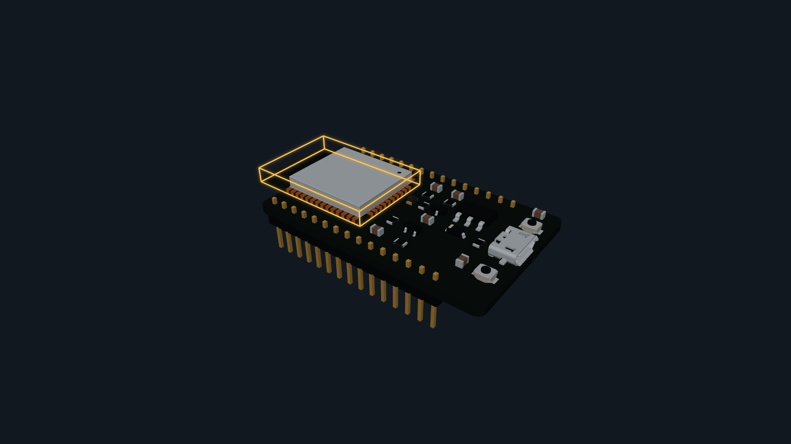
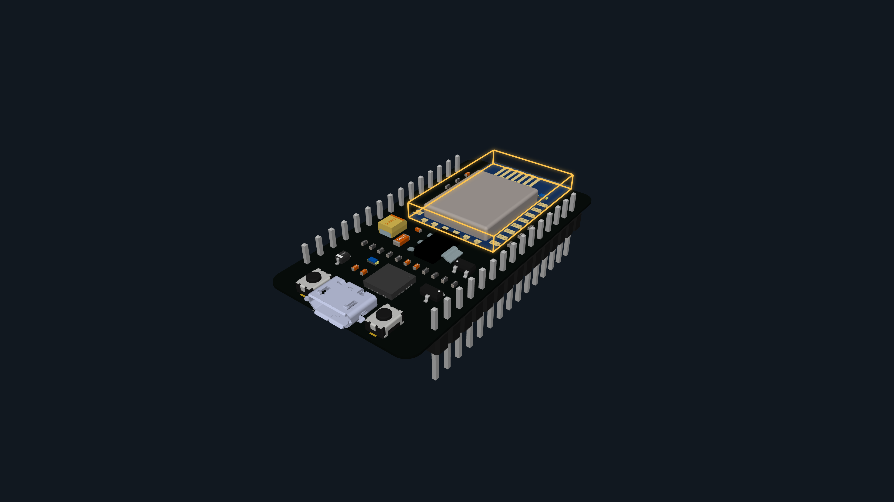
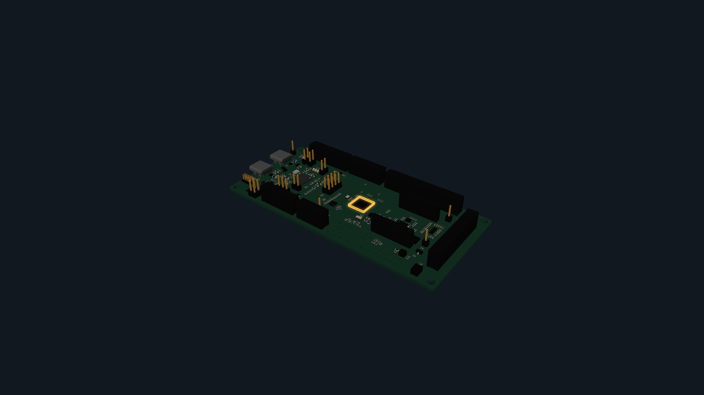
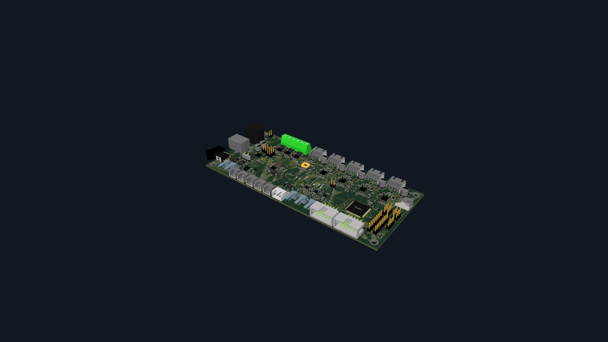
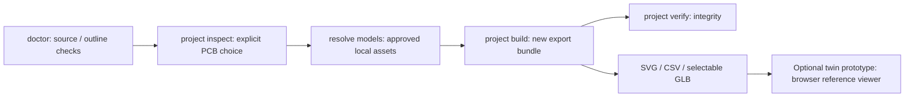
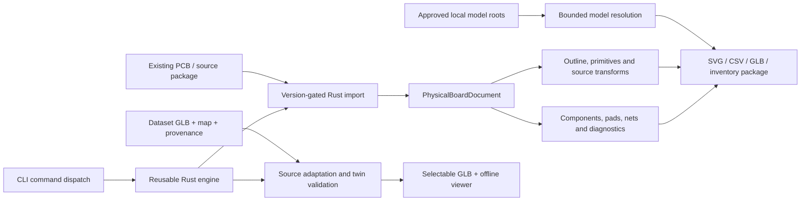
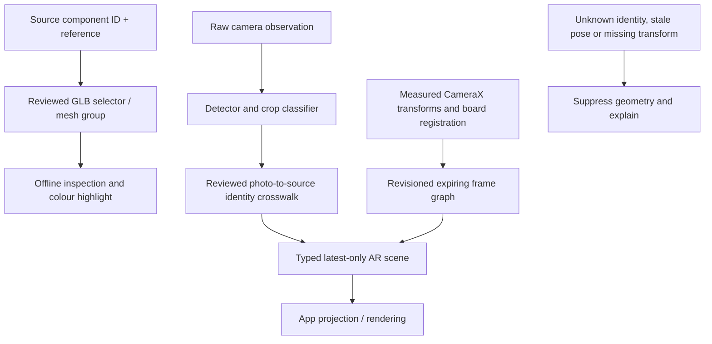
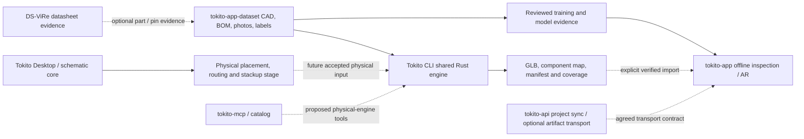

# Tokito CLI

**Offline Rust tooling for turning existing PCB layouts and source models into inspectable, selectable board artifacts.**

Tokito CLI is the physical-board preparation layer of the Tokito ecosystem. It
shares a reusable Rust engine with its command-line front end, preserves source
component identities, and reports incomplete geometry explicitly. The crate
version is **0.1.0**; no GitHub release is published. Selectable reference prototypes are available, while full
KiCad parity, schematic-to-PCB automation and qualified phone AR remain unfinished.

[Try the demos](#selectable-3d-prototypes) · [Quick start](#quick-start) ·
[Commands](#implemented-commands) · [Architecture](#architecture) ·
[Codebase](#codebase-map) · [Afan handover](docs/AFAN_INTEGRATION_HANDOVER.md) ·
[Roadmap](docs/PRODUCT_COMPLETION_PLAN.md) · [Project export bundle](docs/PROJECT_EXPORT_BUNDLE.md)

## Selectable 3D prototypes

These are actual generated/adapted artifacts, not concept images. Each directory
contains a GLB, identity map, twin manifest, preparation report and standalone
viewer. Reference counts include records without package bodies; they are not
physical fitted-component counts.

The **Ultimaker presentation standard** now defines the shared default for
`twin prototype`: neutral source-colour lighting, consistent camera and exact
component selection. Optional material-studio lighting retains authored
roughness/metallic values. **Save 4K PNG** produces a 3840 × 2160 model image
where the graphics device supports it. The emitted `presentation-profile.json`
records the versioned settings. See [the standard and precision
gates](docs/THREED_PRESENTATION_STANDARD.md); visual polish does not qualify
missing bodies, source geometry or physical fit.

| Board | References | Selectable bodies/groups | Current boundary |
|---|---:|---:|---|
| [ESP32 natural-material reference](demo/esp32-natural/) | 26 | 23 | Full source baseline with central module, passives, USB and switches; CP2102 U3 remains missing; photographed variant unqualified |
| [ESP8266 NodeMCU source reference](demo/esp8266/) | 34 | 34 | 62 source body instances from the Rust Altium/STEP experiment; physical pose, surfaces and specimen match unqualified |
| [NXP FRDM-MCXN236 refined](demo/nxp-refined/) | 391 | 351 | U8 and USB connectors replaced with source STEP geometry; 20 placeholders remain; J7/J14/J21 explicitly not fitted |
| [Ultimainboard 2.1.4](demo/ultimaker/) | 574 | 310 | Source assembly with multi-mesh component groups; four package bodies and four spacers unresolved |
| [NXP earlier baseline](demo/nxp-reference/) | 391 | 354 | Retained for comparison; use the refined asset for corrected population/placement |

### ESP32



The ESP32 assembly is generated by the Rust CLI using source PCB placements and
a bounded local VRML library. The natural-material version retains all geometry,
transforms and 23 selectable components from the full source baseline, including
J1 USB, SW1/SW2 switches, D2 LED and U1 module. Eleven explicit material overrides
provide dark solder mask, silver terminals/shield, charcoal parts and copper/gold
tones; these are presentation approximations, not measured reflectance or texture
maps. All 23 browser selections passed in the
[material receipt](demo/esp32-natural/material-acceptance.json).
The [original source-colour demo](demo/esp32/) remains a regression baseline;
neither presentation fills the missing U3 or fabricates new geometry/silkscreen.
See [population audit](docs/ESP32_POPULATION_AUDIT.md) and
[material preview](docs/ESP32_NATURAL_MATERIALS.md).

### ESP8266



The Rust experimental pipeline decodes native Altium identities, embedded STEP
bytes and source body instances, then exports a selectable partial source
assembly. It is not proof that the photographed clone has identical geometry
or population. The frozen model remains separate from later drilled-substrate
work. See [source assembly](docs/ESP8266_SOURCE_ASSEMBLY.md),
[placement evidence](docs/ESP8266_PLACEMENT_RESEARCH.md) and
[drill inventory](docs/EXCELLON_SOURCE_INVENTORY.md).

### NXP FRDM-MCXN236



The refiner replaces U8 and J10/J11 with pinned source package geometry and
corrects their footprint origins. J7/J14/J21 remain semantic records marked
not fitted; no fake connector bodies replace the empty footprints. Other DNP
assembly options and source placeholders remain unresolved for the specimen.
See [refinement sources, transforms and acceptance](docs/NXP_REALISM_UPGRADE.md).

### Ultimainboard



The CLI adapts dataset source geometry into individually selectable component
groups. Ninety-four components span multiple meshes, so App selection must
resolve groups rather than assuming every reference is one direct mesh node.
See [multi-mesh prototype](docs/ULTIMAKER_SELECTABLE_PROTOTYPE.md).

All displayed boards are **unregistered reference prototypes**. Physical
geometry, board/photo fit and AR guidance require their own acceptance gates.
3840×2160 screenshots demonstrate visualization resolution, not CAD accuracy
or phone performance. [Demo provenance and limitations](docs/DEMO_BUNDLE.md)
explain the source and evidence boundaries.

## Quick start

For a command-by-command walkthrough with real output excerpts, generated-file
descriptions and error recovery, read the [CLI command guide](docs/CLI_COMMAND_GUIDE.md).

Use Rust with Cargo; the crate declares Rust 1.87 and edition 2024. Recorded
Windows checks used a newer toolchain and do not establish the minimum-version
or Linux acceptance gates. PowerShell 7 and Python are needed for the local
verification runner; a browser is sufficient to inspect the checked-in demos.

```powershell
cargo build --release --locked
./target/release/tokito-cli.exe --version
./target/release/tokito-cli.exe --help
./target/release/tokito-cli.exe --color always --help
./target/release/tokito-cli.exe doctor
./target/release/tokito-cli.exe help twin
```

Add `--offline` to Cargo commands after the locked dependencies are cached.
At a PowerShell `PS>` prompt, invoke the executable before its flags:
`./target/release/tokito-cli.exe --help`. Bare `help` belongs to PowerShell;
bare `--help` is not a shell command. Tokito is not an interactive shell.
The production engine uses pure Rust dependencies and does not invoke KiCad
or require C/C++ CAD bindings. FreeCAD/KiCad comparisons are separate development
reference checks.

Inspect a delivered model and select an exact reference:

```powershell
./target/release/tokito-cli.exe twin inspect demo/esp32-natural/active.digital-twin.glb --component-map demo/esp32-natural/component-map.json --manifest demo/esp32-natural/active.digital-twin.json
./target/release/tokito-cli.exe twin select demo/esp32-natural/active.digital-twin.glb --component-map demo/esp32-natural/component-map.json --manifest demo/esp32-natural/active.digital-twin.json --reference U1
```

Run the standalone viewers locally:

```powershell
python -m http.server 8765 --bind 127.0.0.1 --directory demo
```

Open `/esp32-natural/index.html`, `/esp8266/index.html`, `/nxp-refined/index.html` or
`/ultimaker/index.html` at `http://127.0.0.1:8765`. Select a reference, click
geometry, orbit, zoom and reset. The HTML includes its GLB payload and requires
no CDN. This loopback server is a desktop demo, not the phone import interface.

## Implemented commands

Use `help <COMMAND...>` or command-specific `--help` for accepted options.
The `pcb` group aliases the supported physical-board commands; its familiar
shape is not a declaration of complete KiCad command compatibility.

| Command | Actual operation |
|---|---|
| `help`, `--help`, `-h`, `version`, `--version`, `-V` | Grouped command discovery, leaf help and version; help accepts a positional input before `--help` |
| `doctor [PROJECT\|BOARD]` | Offline, read-only runtime information or bounded source/import/outline checks; `--board` disambiguation and stable `--json`; does not qualify models, manufacturing or AR |
| `inspect` | Supported PCB/package metadata, identity and placement inventory |
| `project inspect` | Bounded read-only KiCad project-folder discovery, exact PCB choice and source SHA-256 pinning |
| `project build/verify` | Source-pinned offline bundle with placements, outline, top/bottom SVG, GLB coverage, component UUID/selector map and integrity verification; not yet App-importable |
| `validate outline` | Bounded contour/cutout topology report and refusal diagnostics |
| `export placements` | CSV in the saved source board frame; not a manufacturing-position certificate |
| `pcb export pos` | KiCad-reference CSV and ASCII subsets: side, mm/in, bottom X mirror, absolute or auxiliary drill-file origin, SMD/THT and DNP filters; Gerber and variants remain unsupported |
| `export svg` | Partial top/bottom physical-scale view with layer selection; opt-in `--hide-DNP-footprints-on-fab-layers` hides only DNP-owned text/graphics on `F.Fab`/`B.Fab` ([10.0.5 reference](tests/reference/kicad-cli-10.0.5/svg/manifest.json)) |
| `resolve models` / `model inspect` | Caller-approved external asset resolution, checksum-verified KiCad embedded payload intake and optional hash-addressed source-byte export (`--extract-dir`), including closed local-resource bundles for JSON glTF; owner UUID/reference diagnostics and bounded VRML inspection with generated crease-angle normals; copied STEP/glTF bytes are not decoded geometry or selector qualification |
| `export glb` | Validated board shell, bounded VRML97 assembly (`Group`/`Transform` including `scaleOrientation`, `DEF`/`USE`, checked planar polygon `IndexedFaceSet`, and `creaseAngle` smoothing), reference wildcards, native DNP exclusion, and [native unspecified-footprint filtering](docs/KICAD_FOOTPRINT_TYPE_FILTER.md) with explicit coverage, or candidate assignments |
| `model assignments template/verify` | Explicit source-bound model assignment records and checks |
| `model derive-wrl` | Opt-in new VRML candidate with an explicit unused-invalid-material/zero-area-face change report; original source preserved, solid repair not certified |
| `bom reconcile` | Reviewed NXP JSON / ESP32 CSV identity joins, source hashes and ambiguity |
| `twin inspect/prepare/prototype/select` | Hash-bound GLB/map/manifest checks, selector preparation, viewer, exact-reference/authored-class queries, and visibly unverified class hints for missing labels |
| `twin adapt-source` | Source adaptation, with optional reviewed `--board-plane-node` bounds |
| `twin audit-population` | ESP32 reference-BOM comparison without inferring physical placement |
| `dataset inventory/lock/verify/bind/bind-external` | Explicit immutable Git/LFS/local asset inventory, locks and provenance binding |
| `package build/verify` | v0.1 source-and-inventory package and integrity checks |
| `component model envelope` | Evidence-bound provisional rectangular envelope; not a complete generated component |
| `component footprint r0603` | Deterministic two-pad 0603 library-geometry candidate; not a qualified manufacturer land pattern |
| `component footprint inspect` | Bounded read-only `.kicad_mod` pad inventory: number, type, shape, position, size, roundrect ratio, layers, and present round/oval drill dimensions/offsets; reports malformed selected fields and names other uninterpreted clauses without claiming full-record validation |
| `component footprint generate` | Explicit, bounded SMD, plated through-hole (round or oval drill, optional offset), centered round non-plated hole, mixed per-pad technologies, and simple filled/unfilled polygon graphics to a new `.kicad_mod`; no IPC derivation or manufacturer qualification |
| `component footprint library create` | Creates a new, unregistered `.pretty` candidate containing one generated SMD, plated-hole, non-plated round-hole, or mixed-pad footprint; it does not edit `fp-lib-table` or existing libraries |
| `component footprint library inspect` | Read-only, bounded inventory of immediate `.kicad_mod` file counts, names, sizes, hashes, parse statuses, direct pad counts and model-reference counts; it does not validate KiCad semantics or geometry |
| `component footprint library audit` | Read-only observations for parse failures, duplicate internal names and filename/internal-name mismatches; includes inventory hash and ignored-entry list but does not validate KiCad semantics or geometry |
| `component footprint library lock/verify` | Create a deterministic byte-identity lock for the immediate `.kicad_mod` files and report missing/added/changed files; this verifies content identity, not footprint semantics or geometry |

Example physical-layout journey, using a supported routed PCB and **new** output
paths:

```powershell
./target/release/tokito-cli.exe component footprint generate examples/footprints/r0603-reference.json --output target/R_0603_1608Metric.generated.kicad_mod --json
./target/release/tokito-cli.exe component footprint library create examples/footprints/mixed-smd-through-hole.json --output target/MixedHeader.pretty --json
./target/release/tokito-cli.exe component footprint generate examples/footprints/header-1x02-through-hole.json --output target/Header_1x02_P2.54mm.generated.kicad_mod --json
./target/release/tokito-cli.exe component footprint generate examples/footprints/header-1x02-oval-offset.json --output target/Header_1x02_Slotted_P2.54mm.generated.kicad_mod --json
./target/release/tokito-cli.exe component footprint generate examples/footprints/mounting-hole-3mm-npth.json --output target/MountingHole_3mm.generated.kicad_mod --json
./target/release/tokito-cli.exe component footprint generate examples/footprints/sot-23-to236ab.json --output target/SOT-23.generated.kicad_mod --json
./target/release/tokito-cli.exe component footprint inspect tests/fixtures/kicad-10.0.5/R_0603_1608Metric.kicad_mod --json
./target/release/tokito-cli.exe component footprint library create examples/footprints/r0603-reference.json --output target/R0603.pretty --json
./target/release/tokito-cli.exe component footprint library create examples/footprints/header-1x02-through-hole.json --output target/Header.pretty --json
./target/release/tokito-cli.exe component footprint library create examples/footprints/header-1x02-oval-offset.json --output target/HeaderSlotted.pretty --json
./target/release/tokito-cli.exe component footprint library create examples/footprints/mounting-hole-3mm-npth.json --output target/MountingHole.pretty --json
./target/release/tokito-cli.exe component footprint library create examples/footprints/sot-23-to236ab.json --output target/SOT23.pretty --json
./target/release/tokito-cli.exe component footprint library inspect target/R0603.pretty --json
./target/release/tokito-cli.exe component footprint library lock target/R0603.pretty --output target/R0603.lock.json --json
./target/release/tokito-cli.exe component footprint library verify target/R0603.pretty --lock target/R0603.lock.json --json
./target/release/tokito-cli.exe project inspect board-project --board board.kicad_pcb --json
./target/release/tokito-cli.exe inspect board.kicad_pcb --json
./target/release/tokito-cli.exe validate outline board.kicad_pcb --json
./target/release/tokito-cli.exe export placements board.kicad_pcb --output placements.csv
./target/release/tokito-cli.exe pcb export pos board.kicad_pcb --format csv --units mm --side both --output manufacturing-positions.csv
./target/release/tokito-cli.exe pcb export pos board.kicad_pcb --format ascii --units mm --side both --output manufacturing-positions.pos
./target/release/tokito-cli.exe export svg board.kicad_pcb --side top --output top.svg
./target/release/tokito-cli.exe export svg board.kicad_pcb --layers F.Fab --hide-DNP-footprints-on-fab-layers --output fab-populated.svg
./target/release/tokito-cli.exe export svg board.kicad_pcb --side bottom --output bottom.svg
./target/release/tokito-cli.exe export glb board.kicad_pcb --output shell.glb --allow-partial --json-report
./target/release/tokito-cli.exe export glb board.kicad_pcb --output selected.glb --assemble-wrl --project-root board-project --component-filter U1,D1 --json-report
./target/release/tokito-cli.exe export glb board.kicad_pcb --output populated.glb --assemble-wrl --project-root board-project --no-dnp --json-report
./target/release/tokito-cli.exe resolve models board.kicad_pcb --project-root board-project --extract-dir target/board-model-source --json
./target/release/tokito-cli.exe component footprint library audit MyParts.pretty --json
./target/release/tokito-cli.exe package build board.kicad_pcb --output new-board-package
./target/release/tokito-cli.exe package verify new-board-package --json
```

Build a source-pinned, offline export bundle from a selected existing PCB:

```powershell
./target/release/tokito-cli.exe project build C:\Boards\MyProject --board MyProject.kicad_pcb --expect-sha256 <64-hex-source-digest> --output D:\TokitoExports\MyProject --allow-partial --json
./target/release/tokito-cli.exe project verify D:\TokitoExports\MyProject --json
```

`--allow-partial` is required when component models are missing or unsupported.
The bundle is not yet accepted by the Tokito App importer and does not claim
qualified physical geometry or registered AR. See
[Project export bundle](docs/PROJECT_EXPORT_BUNDLE.md) for its schema, limits
and acceptance journey.

A shell is always partial. Missing/unsupported models refuse assembly by default;
partial output requires explicit `--allow-partial`. Assembly resolves only under
approved local roots and supports a bounded VRML97 Group/Transform (including
the standard `scaleOrientation` order)/DEF/USE and planar polygon
`IndexedFaceSet` profile with planarity, winding, area and resource-budget
checks. It derives per-corner normals from `creaseAngle` across manifold shared
edges and transforms them with the required inverse-transpose normal matrix.
Explicit `Normal` nodes and textures remain unsupported. `--component-filter` accepts case-sensitive
comma-separated reference patterns with `*` and `?`; empty list items are
ignored and a no-match pattern produces a board-only export. Filter selection
has a board-wide work budget and happens before model paths are resolved. Tokito
defines `?` as one Unicode scalar; KiCad parity has only been verified for ASCII
references. `--no-dnp` excludes components carrying KiCad's native `attr dnp`
marker. These filters currently apply to VRML-to-GLB assembly only. STEP
board export and STEP model tessellation are not implemented; skipping a STEP
reference does not produce a STEP artifact. Unresolved models are reported
rather than replaced by silent cuboids.

`export placements` is the original-source coordinate inventory. `pcb export
pos` is a separate manufacturing projection with CSV and ASCII formats. The
CSV subset has pinned KiCad 10.0.5 and 10.0.7 comparisons; ASCII has pinned
KiCad 10.0.5 comparisons. See the [POS export contract](docs/PCB_POSITION_EXPORT.md),
[CSV evidence](tests/reference/kicad-cli-10.0.5/pos/manifest.json) and
[ASCII evidence](tests/reference/kicad-cli-10.0.5/pos-ascii/manifest.json).
ASCII output is bounded to 1,024 UTF-8 bytes per identity field and 32 MiB
total; control, line-separator and bidi-format characters are refused. See the
contract for the narrow Unicode/display-width limitation and unsupported
variants/Gerber options.

## Command flow and actual output



All command groups are discoverable from `--help`; use leaf help for full
arguments. For example, `pcb export --help`, `model --help`, and
`component footprint library --help` list their implemented children.

Actual SparkFun inspection and outline validation in the live CLI demonstration returned:

```text
Footprints: 20
Pads: 29
Referenced 3D models: 7
Nets: 9
Physical outline: valid within supported scope (4 primitives, 1 contours; mm, source Y-down)
```

Its top SVG contained 109 supported geometry items at 51.900 × 51.900 mm, with
four omitted-dimension diagnostics. The manufacturing-position export contained
17 rows, including:

```csv
Ref,Val,Package,PosX,PosY,Rot,Side
"C2","10uF","C_0603_1608Metric",136.525000,-106.680000,-90.000000,top
```

The ASCII command emits the same selected placements in a KiCad-style table
with four fractional digits. A live SparkFun fixture run wrote 17 rows:

    ### Footprint positions - created on 2026-10-18T08:50:47 ###
    ### Printed by Tokito CLI version 0.1.0
    ## Unit = mm, Angle = deg.
    ## Side : All
    # Ref     Val               Package                              PosX       PosY       Rot  Side
    FID2      Fiducial_0.5mm    Fiducial_0.5mm_Mask1mm           165.1000  -118.1100  180.0000  bottom
    FID3      Fiducial_0.5mm    Fiducial_0.5mm_Mask1mm           121.9200   -74.9300  180.0000  bottom
    C2        10uF              C_0603_1608Metric                136.5250  -106.6800  -90.0000  top

| Operation | Output |
| --- | --- |
| `inspect`, `doctor`, `validate outline` | Human report or supported `--json` report |
| `export svg`, `export placements`, `pcb export pos` | Partial `.svg`, source-inventory `.csv`, manufacturing-position `.csv` or `.pos` |
| `export glb` | `.glb`; optional JSON coverage on stdout |
| `project build` | New source-bound directory with views, placement/selector records, GLB, diagnostics and manifest |
| `component footprint generate` | New `.kicad_mod` and explicit candidate report, including mixed pad types |
| `component footprint library create/lock` | New `.pretty` candidate directory or file-identity lock JSON |
| `twin prototype` | Offline `index.html`, GLB, map/index, manifest and preparation report |
| `dataset bind/lock`, `package build` | Source-binding/lock JSON or a source-and-inventory package |

Human help and doctor use Tokito mint `#08C9AA`, indigo `#5456F0` and semantic
status colours where supported. Use leading `--color always` for an explicit
RGB preview, `--no-color` for plain text, or `NO_COLOR` to suppress colour.
Auto mode requires a recognised true-colour terminal; machine JSON stays plain.
The [command guide](docs/CLI_COMMAND_GUIDE.md) provides copyable input setups,
all command families, real output excerpts, palette provenance and recovery steps.

The live demo exposed a Git-LFS pointer and a missing candidate coverage file.
The CLI now names those problems and their input paths instead of reporting an
unrelated parser error or a bare OS error. It does not silently download assets,
invent coverage, overwrite files, or bypass source binding.

## Inputs, outputs and compatibility

| Boundary | Supported today | Important limit |
|---|---|---|
| KiCad `.kicad_pcb` | Reviewed format-date range `20211014`–`20260206`, bounded S-expression import | A supported subset, not full version/feature parity; out-of-range or missing dates refused |
| Tokito package v0.1 | Preserved source, inspection and placement inventory with digests | `mobileImportReady: false`; no embedded SVG/GLB/STEP; not the App context/twin format |
| GLB + component map + manifest | Self-contained selectable candidate validation/preparation | Selection and integrity do not qualify physical geometry or AR pose |
| Dataset/BOM assets | Explicit source locks, Git/LFS inventory and reviewed schema joins | Same name/count does not establish board variant or photo-to-CAD identity |
| Altium and STEP | Original Rust experimental source/mesh pipelines and pinned comparisons | Not general production import/export support |
| Desktop schematic JSON | Future adapter / design-stage input | Symbol coordinates do not define physical footprints, routing or board geometry |

The physical engine retains source UUIDs/native identities, units, model
references and diagnostics. A malformed, unsupported or unqualified feature
remains explicit. No zone filling, DRC, autorouting, universal STEP export,
complete schematic renderer or production IPC/package-family footprint library
generator is claimed. The bounded explicit SMD, plated round/oval/offset-hole,
non-plated round-hole, and mixed per-pad technology writers produce geometry
candidates only. Custom pads and IPC/package-family calculations are unsupported.
Footprint library `audit` reports parse failures, duplicate parsed internal
names and filename/internal-name mismatches; it is a naming/structure check,
not KiCad semantic validation, KLC validation or physical qualification.
See [package contract](docs/TOKITO_BOARD_PACKAGE_V0.md),
[topology limits](docs/PCB_TOPOLOGY.md), [model handling](docs/MODEL_RESOLUTION.md)
and [KiCad completion gates](docs/KICAD_COMPLETION_GATES.md).

## Architecture



`src/main.rs` owns process entry, `src/cli.rs` command dispatch, and `src/lib.rs`
the public engine boundary. `load_kicad_board`, `load_board_input` and
`PhysicalBoardDocument` provide import, typed engineering inventory, supported
geometry, outline validation, source-frame placement inventory and typed
manufacturing-position CSV/ASCII exports without launching a subprocess. The
raw inventory and manufacturing exports are separate by design; neither
changes the v0.1 package schema.
[Canonical API](docs/CANONICAL_ENGINE.md) documents semantics and compatibility.

### Component selection and AR separation



The CLI exports identity and geometry; the App owns camera lifecycle, local
inference, registration and presentation. Manual 3D inspection creates no pose.
Detector class, photo annotation, source UUID/native ID and GLB selector are
separate identities; accepted correspondence must join them. Missing or stale
registration suppresses positional guidance.

### Tokito ecosystem



The phone remains the primary local runtime; PC preparation is currently
accepted. Desktop can adopt the same Rust engine once its physical-input
contract is agreed. Schematic-to-PCB needs a real layout stage. API sync or
artifact storage does not by itself install/validate a twin, and DS-ViRe is
part evidence rather than physical placement authority.

Friends actively maintain the App and dataset. Consume immutable commits and
materialized assets from [tokito-app-dataset](https://github.com/TokitoAI/tokito-app-dataset);
`devboard_ar_dataset` is not the active corpus. Exact ownership, import files,
revision/expiry gates, YOLO joins and productization steps are in the
[Afan handover](docs/AFAN_INTEGRATION_HANDOVER.md) and
[pasteable integration prompt](docs/AFAN_CODEX_INTEGRATION_PROMPT.md).

## Codebase map

This map covers the application modules and supporting trees. The linked
folders retain full per-fixture, per-board and historical evidence inventories;
`target/` is ignored local output rather than distributable source.
The [versioned repository map](docs/REPOSITORY_MAP.md) lists the full tracked tree.

```text
tokito_cli/
├── Cargo.toml / Cargo.lock       Locked Rust crate and binary
├── AGENTS.md                    Repository instructions
├── README.md                    Product and developer entry point
├── src/
│   ├── main.rs                  Process entry and exit
│   ├── cli.rs                   Command parsing, help and dispatch
│   ├── cli_doctor.rs            Offline runtime / source / outline diagnostics
│   ├── cli_presentation.rs      Tokito terminal palette and colour policy
│   ├── lib.rs                   Public physical engine API
│   ├── document.rs              Typed source-semantic board document
│   ├── geometry.rs / topology.rs Supported render geometry and contours
│   ├── glb.rs                   Board-shell GLB generation
│   ├── component_pose.rs        Source/model coordinate composition
│   ├── model_resolver.rs        Approved-root local model resolution
│   ├── model_asset_export.rs    Hash-addressed source-payload folder export
│   ├── gltf_bundle.rs           Safe local JSON glTF buffer/image closure capture
│   ├── model_mesh.rs            Bounded VRML geometry/material reader
│   ├── model_mesh/zero_area.rs  Explicit exact-zero-face derivation
│   ├── model_assembly.rs        Supported component assembly
│   ├── model_assignments.rs     Evidence-bound model assignment contract
│   ├── assigned_assembly.rs     Assigned candidate bodies
│   ├── component_forge.rs       Provisional envelope generation
│   ├── digital_twin.rs          Twin admission, identities and selectors
│   ├── source_candidate.rs      Source adaptation and substrate bounds
│   ├── twin_viewer.rs           Offline selectable viewer generation
│   ├── bom.rs / population_audit.rs BOM identity and coverage comparison
│   ├── dataset.rs              Source lock and local integrity
│   ├── dataset_git.rs          Immutable Git/LFS inventory
│   ├── dataset_external.rs     External asset provenance binding
│   └── package_input.rs / strict_json.rs Package parsing and strict JSON
├── examples/inspect_engine.rs   Separate Rust library consumer
├── experiments/
│   ├── altium-evaluation/       Native records, embedded STEP, pose,
│   │   └── src/                association, board inputs, drills/substrate
│   ├── step-evaluation/         Units, occurrences, faces, candidate meshes
│   │   ├── src/                Bounded experimental STEP evaluation
│   │   ├── tests/              Unit/negative CLI regressions
│   │   └── examples/           Analytic torus reference checks
│   └── twin-refinement/         Source-mesh replacement and presentation
│       ├── src/                Original Rust refiner and strict JSON
│       └── profiles/           Pinned explicit material specifications
├── scripts/
│   ├── verify-local.ps1        Isolated builds, checks and evidence receipts
│   ├── real-cli-e2e.ps1        Actual release CLI acceptance
│   └── evaluate-step-reference.py Off-device independent CAD QA
├── tests/
│   ├── *_api.rs / engine_api.rs Rust consumer/geometry/identity tests
│   ├── *_e2e.py                Actual subprocess and dataset journeys
│   ├── *_browser.js            Real-browser selection and viewer checks
│   └── fixtures/              Pinned CAD, old-package and negative inputs
├── demo/
│   ├── bundle-manifest.json    Frozen artifact hashes and provenance
│   ├── esp32/                 23-body source-reference demo
│   ├── esp32-natural/         Same 23-body geometry, explicit material profile
│   ├── esp8266/               34-component source-reference demo
│   ├── nxp-refined/           351-body refined prototype and evidence
│   ├── nxp-reference/         Earlier baseline
│   └── ultimaker/             Multi-mesh source assembly
├── docs/                      Architecture, contracts, research, handover
│   └── evidence/              Scoped checked-in verification receipts
└── target/                    Ignored builds, intakes, prototypes, receipts
```

## Documentation index

| Area | Start here |
|---|---|
| Architecture and public API | [Architecture](docs/ARCHITECTURE.md), [canonical engine](docs/CANONICAL_ENGINE.md), [native formats](docs/NATIVE_FORMAT_ARCHITECTURE.md) |
| V1 requirements and quality ledger | [V1 plan](docs/CLI_V1_PLAN.md) |
| CLI-only preview and production release gates | [Release readiness](docs/CLI_RELEASE_READINESS.md) |
| CLI commands, actual output and recovery | [Command guide](docs/CLI_COMMAND_GUIDE.md) |
| STEP solid ownership and remaining reader failures | [Per-solid reference evidence](docs/STEP_SOLID_REFERENCE.md) |
| Experimental planar repair and independent comparison | [Repair architecture and gates](docs/STEP_PLANAR_REPAIR.md) |
| Accurate component bodies and the rejected spline case | [Geometry recovery research, independent measurements and Rust implementation plan](docs/GEOMETRY_RECOVERY_PLAN.md) |
| Full repository tree | [Versioned source and artifact map](docs/REPOSITORY_MAP.md) |
| Physical exports | [Topology](docs/PCB_TOPOLOGY.md), [GLB](docs/GLB_EXPORT_ARCHITECTURE.md), [model roots](docs/MODEL_RESOLUTION.md), [assignments](docs/MODEL_ASSIGNMENTS.md) |
| Dataset provenance | [Board intake](docs/DATASET_BOARD_HANDOFF.md), [source locks](docs/DATASET_SOURCE_LOCK.md), [Git/LFS](docs/DATASET_GIT_INVENTORY.md), [external binding](docs/DATASET_EXTERNAL_BINDING.md) |
| Board prototypes | [Demo bundle](docs/DEMO_BUNDLE.md), [ESP32](docs/ESP32_POPULATION_AUDIT.md), [ESP8266](docs/ESP8266_SOURCE_ASSEMBLY.md), [NXP](docs/NXP_REALISM_UPGRADE.md), [Ultimaker](docs/ULTIMAKER_SELECTABLE_PROTOTYPE.md) |
| Selection and integration | [Digital twins](docs/DIGITAL_TWIN_SELECTION.md), [board/AR audit](docs/BOARD_AR_DATASET_AUDIT.md), [ecosystem map](docs/ECOSYSTEM_CONTRACT_MAP.md), [Afan handover](docs/AFAN_INTEGRATION_HANDOVER.md) |
| Component generation | [Forge architecture](docs/COMPONENT_FORGE_ARCHITECTURE.md), [qualification](docs/COMPONENT_FORGE_QUALIFICATION.md), [BOM plan](docs/BOM_COMPONENT_QUALIFICATION.md) |
| Project and footprint intake | [Bounded project selection and 0603 candidate](docs/PROJECT_INTAKE_AND_FOOTPRINT.md) |
| KiCad research | [Behavior](docs/KICAD_CLI_BEHAVIOR.md), [10.0.5 filter audit](docs/KICAD_10_0_5_FILTER_AUDIT.md), [parity matrix](docs/KICAD_CLI_PARITY_MATRIX.md), [completion gates](docs/KICAD_COMPLETION_GATES.md), [3D quality gates](docs/KICAD_3D_QUALITY_GATES.md) |
| Product completion | [Dependency-ordered plan](docs/PRODUCT_COMPLETION_PLAN.md), [active goal history](docs/GOAL_TRACKER.md) |
| Testing and delivery | [Local verifier](docs/CI_AND_DELIVERY.md), [fixture provenance](docs/PCB_FIXTURE_CORPUS.md), [output locations](docs/LOCAL_OUTPUT_LOCATIONS.md), [goal tracker](docs/GOAL_TRACKER.md) |

Some progress documents preserve earlier checkpoints. Use their dated evidence,
current artifacts and source hashes rather than treating an old count as today's
capability. Documentation is not an independent test receipt.

## Verification and delivery

```powershell
cargo fmt --all --check
cargo test --offline --locked
cargo clippy --offline --locked --all-targets -- -D warnings
pwsh -File scripts/verify-local.ps1
```

The PowerShell 7 runner creates isolated build and delivery directories under
`target/`, fingerprints source inputs and the release binary, runs subprocess
journeys and writes a receipt only when selected gates pass. Real dataset
profiles need their explicit paths, source locks and reference reports; running
the base profile does not establish every board's acceptance. Use
`Get-Help scripts/verify-local.ps1` and [delivery documentation](docs/CI_AND_DELIVERY.md)
for profile inputs. Browser and physical-device checks are separate gates.

The accepted NXP checkpoint has a [41-gate Windows receipt](docs/evidence/nxp-refined-local-verification-20261011.json)
and [351-selector browser receipt](demo/nxp-refined/browser-acceptance.json).
Those receipts bind their recorded inputs; they do not certify later edits,
Linux/MSRV, surfaces, physical population, App import or AR. New source changes
require fresh relevant verification and independent review before pushing.

The subsequent [ESP32 presentation/documentation receipt](docs/evidence/esp32-presentation-local-verification-20261011.json)
records rerun formatting, Rust tests, warnings-as-errors Clippy, release build
and actual CLI subprocess acceptance on unchanged implementation source. It
also binds the material/geometry comparison, all 23 selections, 4K output and
offline interaction after HTTP load. Fresh `file://` automation was unavailable
and remains skipped; the full historical 41-gate suite was not rerun for this
presentation slice. App import and physical AR remain unverified.

GitHub Actions and hosted artifact uploads are unused by request. Delivery uses
feature branches and PRs rather than direct main pushes. Keep binary builds,
bulk input datasets and transient caches local; committed demo artifacts have
explicit provenance. Current canonical workspace:
`D:\kannan\projects\tokito ecosystem\tokito_cli`.

## Next milestones

- Complete missing component bodies, terminals, pads/drills, source transforms
  and independent surface/placement comparisons for each exact board variant.
- Reconcile fitted population and reviewed photo/source/selector identities.
- Stabilize offline App import, group-aware selection and versioned asset updates.
- Qualify YOLO correspondence and calibrated AR on real devices, including
  lifecycle loss, orientation/flip, uncertainty, memory and thermal behavior.
- Integrate the shared Rust engine into Desktop/MCP without duplicating geometry.
- Build the physical placement/routing stage for schematic-to-board generation.
- Complete the agreed KiCad command and footprint-library matrix through original
  Rust implementations and independent reference comparisons.

A rendered board or successful selector does not complete the engineering
product. [The product completion plan](docs/PRODUCT_COMPLETION_PLAN.md) tracks the
remaining gates; [goal history](docs/GOAL_TRACKER.md) retains earlier evidence.
