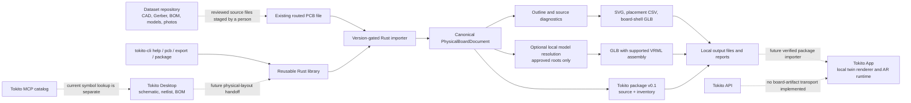

# Tokito CLI

Tokito CLI is a new Rust project for importing existing PCB layouts and preparing board artifacts for the Tokito ecosystem. Its first supported input is a declared subset of KiCad `.kicad_pcb` files whose format date is between `20211014` (KiCad 6) and `20260206` (the version reviewed in KiCad 10.0.7). Older, newer, or missing format versions are rejected until their structure is reviewed. Schematic-to-PCB design comes later.

The canonical local workspace is `F:\kannan\projects\tokito ecosystem\tokito_cli`. The duplicate space-named checkout was removed after verifying its two documents were unchanged at the same commit and already superseded here. Sibling repositories remain read-only.

The [App/API native bridge audit](docs/APP_API_BRIDGE_AUDIT.md) pins the updated GitHub sources, distinguishes physical-session sync from board-package import, and records the remaining cloud/mobile contracts. [Team handoff](docs/TEAM_HANDOFF.md) lists what the App and dataset owners need to provide.

All boards in the dataset are intended targets, with support tracked per exact
revision and adapter. The [Ultimainboard sample audit and dataset intake](docs/DATASET_BOARD_HANDOFF.md)
record the pinned metadata checks, mixed STEP units, unverified model assignments
and remaining offline/registration requirements. Dataset availability does not
mean native Altium/STEP import or full-board AR is implemented.

## Current status

`bom reconcile` reads the reviewed dataset NXP JSON or ESP32 CSV schemas and
joins exact references to unique PCB UUIDs. It retains source hashes, candidate
part numbers, DNP/assembly uncertainty, quantity conflicts and missing identities.
Actual MCXN236/ESP32 runs matched 391/24 BOM references. The additional records
are 190 anonymous MCXN236 footprints and two ESP32 placeholder references, not
evidence of missing physical bodies. This is identity reconciliation, not generated
component CAD or verified physical assembly. See the [BOM qualification plan](docs/BOM_COMPONENT_QUALIFICATION.md).

Milestones A and B provide a reusable `tokito_cli` Rust library with a typed `PhysicalBoardDocument` and a physical `OutlineReport`. Milestone C includes a board-shell GLB and a bounded assembly path: `export glb --assemble-wrl` resolves caller-approved local paths, accepts only the flat triangle VRML97 profile, derives supported copper/core/prepreg mounting planes, and emits one renderable node named `ref:<reference>` per uniquely identified component. That node owns a mesh with separate primitives for imported model parts and includes footprint UUID/source metadata. This matches the App's documented prefix-plus-reference selector shape; App package import and Android selection have not been tested. Missing, ambiguous, hidden, unsupported, STEP, glTF, and GLB models are reported with explicit reasons. Aggregate triangle and report limits bound output. A repeatable external KiCad 10.0.5 GLB capture establishes one non-origin 90-degree component-placement baseline, but it is not 10.0.7 parity. Complete component coverage and an independent KiCad-export geometry comparison remain open. Inspection, placement, package, SVG and GLB share source identities; CLI dispatch stays separate. See the [architecture](docs/ARCHITECTURE.md), [public API](docs/CANONICAL_ENGINE.md), [topology limits](docs/PCB_TOPOLOGY.md), [model operations](docs/MODEL_RESOLUTION.md), [GLB export architecture](docs/GLB_EXPORT_ARCHITECTURE.md), and [external GLB reference](docs/KICAD_GLB_REFERENCE.md).

The executable reads bounded KiCad PCB S-expressions, reports source/component inventory, exports placement CSV, and exports partial physical-scale SVG with layer selection and top/bottom views. `validate outline` provides a separate JSON or text physical topology report; unsupported, open, crossed, overlapping or ambiguous outlines are rejected for physical SVG and GLB export while their source inventory remains inspectable. `export glb` triangulates and extrudes a validated board shell, then independently validates the self-contained GLB container. A shell-only export always requires `--allow-partial`; an assembled export also refuses unresolved models unless the user explicitly permits partial output. Geometry includes supported footprint graphics/text, simple pads/drills, segments/arcs, vias, and stored filled-zone polygons. SVG retains source IDs and parent footprint UUIDs. Text uses approximate SVG fonts; full KiCad plot fidelity and DRC are unverified.

`package build` preserves the source and inventory with SHA-256 digests. `package verify` validates the v0.1 contract, artifact/source integrity and source consistency; inspection, placement, SVG, and GLB exports can also consume that Tokito package directory. It remains a source-and-inventory package with no generated SVG/GLB/STEP embedded and is not accepted by the phone. Placement CSV retains excluded and placeholder footprints and uses raw source anchors; it is not a manufacturing-position file. `pcb` is a command group alias for the existing routed-board commands; it mirrors KiCad's discoverable structure without claiming KiCad's unimplemented schematic, symbol, footprint, jobset, Gerber or STEP operations. Tokito is an original Rust implementation and does not invoke KiCad or copy/translate its code.

The pinned corpus includes SparkFun Basic, Pico/UNO community conversions, NXP MCXA ESC, the Raspberry Pi Press RP2040 Game Controller, an official KiCad NFC demo, the routed Porcupine board, and unchanged original LumenPnP vacuum-adapter PCB/stored profile. The RP2040 source and same-commit KiCad 7 Gerber profile match all 644 valid outline lines exactly; the NFC profile remains a 22-entity reference for an intentionally open outline that the validator rejects. Porcupine has five cutouts and 607 routed copper arcs. The original LumenPnP reference validates eight curved/circular outline entities and emitted SVG path/circle geometry; renderer fidelity remains unverified. These fixtures are not certified Tokito product boards. See [fixture provenance](docs/PCB_FIXTURE_CORPUS.md).

The CLI's v0.1 Tokito package schema and source/inventory writer are implemented. This is an initial exchange format, not the complete canonical board package or a phone import contract. The App remote snapshot inspected on 2026-10-10 defines native GLB/context validation and reference-based selection, but its mobile bridge has no board-package import operation. See [the package contract and limits](docs/TOKITO_BOARD_PACKAGE_V0.md) and the [pinned ecosystem contract map](docs/ECOSYSTEM_CONTRACT_MAP.md). Other vendor formats remain separate, explicitly scoped adapters.

### Component Forge: bounded prototype

The first pure-Rust component-generation command accepts an explicit nominal body specification and writes a deterministic rectangular VRML envelope. The generic subprocess test binds the candidate to a fixture PCB identity and emits one selectable partial-GLB component node. On the pinned FRDM-MCXN236 dataset case, U11 has existing custom footprint pads and a missing model; no footprint is rewritten. Its nominal NXP body envelope is generated and assigned as a candidate, but the current board lacks canonical stackup and the assigned U11 model is withheld from the board GLB under the combined stackup-or-outline gate. This prototype is not a qualified component model. See [architecture](docs/COMPONENT_FORGE_ARCHITECTURE.md), [specification](docs/COMPONENT_FORGE_SPECIFICATION.md), [dataset qualification](docs/COMPONENT_FORGE_QUALIFICATION.md), and [open-source review](docs/COMPONENT_FORGE_OPEN_SOURCE_REVIEW.md).

## Architecture and data flow

The pure-Rust twin commands audit an existing GLB/map/manifest, prepare isolated mesh-bearing reference selectors, and query exact references or authored component-class labels. Preparation preserves geometry and transforms, updates hashes, and reports missing/unmapped geometry. It creates an unregistered reference candidate; colour highlighting, board-reference admission, mobile import and physical AR registration remain separate App stages. See [the CLI flow, architecture and acceptance roadmap](docs/DIGITAL_TWIN_SELECTION.md).



The dataset provides candidate engineering and photo assets; the CLI does not automatically crawl or import that repository. Desktop schematic, netlist, and BOM data do not define footprint placement, board outline, stackup, or routing. The dashed Desktop/App/API paths are integration work, not existing workflows. For the current module map and step-by-step behavior, see [Architecture](docs/ARCHITECTURE.md).

## Research

- [BOM-driven component geometry and validation plan](docs/BOM_COMPONENT_QUALIFICATION.md)
- [Offline model assignments, selectable bodies and qualification receipts](docs/MODEL_ASSIGNMENTS.md)
- [Component Forge architecture, specification, dataset qualification, and upstream review](docs/COMPONENT_FORGE_ARCHITECTURE.md)

- [KiCad-quality 3D gates and actual dataset comparison](docs/KICAD_3D_QUALITY_GATES.md)
- [KiCad CLI behavior analysis](docs/KICAD_CLI_BEHAVIOR.md)
- [KiCad CLI compatibility matrix](docs/KICAD_CLI_PARITY_MATRIX.md) (10.0.7 is proposed as the behavior baseline pending confirmation)
- [Tokito ecosystem integration boundaries](docs/ECOSYSTEM_INTEGRATION.md)
- [Tokito ecosystem contract map](docs/ECOSYSTEM_CONTRACT_MAP.md)
- [Implementation gates](docs/IMPLEMENTATION_GATES.md)
- [Native formats and 3D architecture](docs/NATIVE_FORMAT_ARCHITECTURE.md)
- [Canonical Rust engine API](docs/CANONICAL_ENGINE.md)
- [Current results and personal-AI handoff](docs/PERSONAL_AI_HANDOFF.md)

Build locally with `cargo check --offline --locked` after dependencies are cached. The pure-Rust dependency graph includes pinned `earcut` for contour triangulation and `gltf` for independent GLB parsing, plus pinned `serde` and `serde_json`; it has no native CAD dependency. Run `cargo test --offline --locked`, `cargo fmt --all --check`, and `cargo clippy --offline --locked --all-targets -- -D warnings`.

Verification and binary delivery stay local to conserve the GitHub Actions quota. The repository's workflow file was removed before PR creation; the PowerShell 7 runner performs the full local gates, release build, E2E and historical compatibility checks. Binaries and receipts default to ignored target/delivery/local/; TargetBase and DeliveryBase can put build/test outputs and delivery evidence on a chosen local volume such as F:. See [local delivery](docs/CI_AND_DELIVERY.md).

```text
tokito-cli --help
tokito-cli help pcb export glb
tokito-cli help export glb
tokito-cli pcb export glb -h
tokito-cli pcb export glb --help
tokito-cli --version
tokito-cli inspect board.kicad_pcb --json
tokito-cli bom reconcile board.kicad_pcb --bom bom-items.json --format nxp-json --json
tokito-cli bom reconcile board.kicad_pcb --bom bom-components.csv --format esp32-csv --json
tokito-cli pcb --help
tokito-cli pcb inspect board.kicad_pcb --json
tokito-cli resolve models board.kicad_pcb --project-root "F:\boards\project" --library-root "F:\models\KiCad8" --model-var "KICAD8_3DMODEL_DIR=F:\models\KiCad8" --json
tokito-cli model inspect resistor.wrl --units kicad-wrl --json
tokito-cli validate outline board.kicad_pcb --json
tokito-cli export svg board.kicad_pcb --side top --output top.svg
tokito-cli export svg board.kicad_pcb --side bottom --output bottom.svg
tokito-cli export glb board.kicad_pcb --output board-shell.glb --allow-partial --json-report
tokito-cli export glb board.kicad_pcb --output board-assembly.glb --assemble-wrl --project-root "F:\models\kicad" --model-var "KICAD8_3DMODEL_DIR=F:\models\kicad" --allow-partial --json-report
tokito-cli package build board.kicad_pcb --output new-package
tokito-cli package verify new-package --json
tokito-cli inspect new-package --json
tokito-cli export svg new-package --side top --output package-top.svg
tokito-cli export glb new-package --output package-shell.glb --allow-partial --json-report
```

Desktop-native schematic JSON, project archives and symbol libraries are distinct document kinds whose adapters remain future work; accepting a Tokito board package does not imply they already produce physical PCBs.

The input-byte ceiling limits bytes read from disk; parser tokens and the in-memory syntax tree can consume more memory than the source file size.

## Constraints

- Pure Rust dependency graph; no C/C++ bindings or native CAD runtime.
- Existing board layouts first; schematic-to-PCB later.
- Offline package generation and local phone use must not depend on sign-in or network.
- Unsupported geometry or missing models must produce explicit diagnostics; partial data must not be labeled a faithful digital twin.
- KiCad format documentation and behavior can guide compatibility. KiCad source code remains GPL-licensed and is not copied or translated here.
