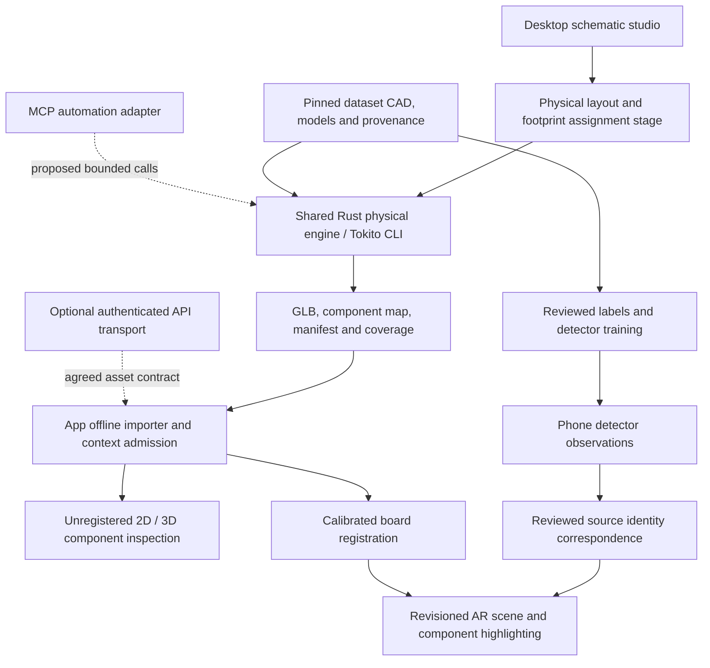

# Afan integration handover: selectable board prototypes

Status recorded on 11 October 2026. This is the integration guide for the frozen
CLI prototype delivery in [PR #29](https://github.com/TokitoAI/tokito-cli/pull/29),
with code/demo commit `74bee98ca07bdcc75c93ae7b9658542808654968` and documentation
head `f28914e1cab0b19c029b81c28084c87418b5aa13`. Subsequent branch work must be
verified against its own head. App, Desktop, API and dataset work belongs to
their respective owners; this document does not authorize changes to them.

The 11 October continuation has locally integrated Afan's PR #31/#33 code
through `68efbc84223964d6cdc5f45233555d5f8738b7fd`. An ESP8266 assembly prototype
has now been generated by the Rust experiment: 34 native identities, 62 source
bodies and 405,194 triangles, approximately 48.7 MB. Its source is the CP2102
NodeMCU reference; source/specimen equivalence remains unverified. Current
prototype acceptance and delivery gates are still running, and these new outputs
are not yet claimed pushed or production-qualified by this checkpoint.

## What Afan can use now

The CLI imports a supported PCB subset, reports its engineering inventory,
exports partial 2D views and placements, validates supported contours, prepares
selectable 3D reference assets, and makes a self-contained browser demo. The Rust
engine is reusable independently of terminal argument parsing. It does not call
KiCad to perform its production exports.

| Board / artifact | Delivered | Still required |
|---|---|---|
| ESP32 community-layout reference | Rust-generated partial assembly; 26 component records, 23 selectable components; central U1 module is present | Missing CP2102 U3; source/photo variant and physical fit qualification |
| Ultimainboard 2.1.4 | Dataset source geometry adapted into 310 selectable groups for 574 references | Four package bodies and four spacers unresolved; group-aware App selection; physical registration |
| NXP Rev C source-reference baseline | Dataset source geometry adapted into 354 selectors for 391 references | Latest dataset asset intake and physical population/placement review; placeholder qualification |
| ESP8266 / ESP-12E NodeMCU | Native Altium source inventory, Rust STEP processing and new local source-reference assembly; 34 identities, 62 source bodies, 17 embedded models | 34 selectable components and browser/CLI E2E passed; physical specimen, pose and surface acceptance remain unqualified |

All four delivered demos are unregistered references. Physical fit and positional
guidance are unqualified. A missing selector is explicit missing coverage, not
an invisible complete component. 3840×2160 screenshots demonstrate rendering
resolution; they do not certify dimensions, materials or alignment.

## Files to access first

Use the checked-in files from the PR branch, rather than an old local server URL
or a `target/` path on another developer's machine.

| Path | Purpose / consumer |
|---|---|
| [demo/README.md](../demo/README.md) and [demo/bundle-manifest.json](../demo/bundle-manifest.json) | Entry point and exact byte sizes/hashes for the frozen delivery |
| `demo/esp32/`, `demo/ultimaker/`, `demo/nxp-reference/` | One independent asset set per exact reference variant |
| `active.digital-twin.glb` in each set | Geometry, materials and selectable component nodes/groups |
| `active.digital-twin.json` | Twin identity, context revision, GLB SHA-256/size, metre/Y-up convention, bounds and qualification flags |
| `component-map.json` | Source component identity, readable reference, authored class claim, selector and missing/verification state |
| `component-index.json` | Prepared selector index; inspect together with the map, not as a replacement for source identity |
| `prepare-report.json` | Completeness, unresolved coverage and consumer-compatibility results |
| `index.html` | Self-contained offline browser demo; embedded model is not an Android importer |
| [src/lib.rs](../src/lib.rs), [src/document.rs](../src/document.rs) | Rust engine API and typed source-semantic physical document |
| [src/cli.rs](../src/cli.rs) | Implemented command/help contract |
| [src/digital_twin.rs](../src/digital_twin.rs), [src/twin_viewer.rs](../src/twin_viewer.rs) | Asset admission/selection and prototype generation |
| [docs/DEMO_BUNDLE.md](DEMO_BUNDLE.md) | Frozen artifact provenance, demonstration instructions and evidence limits |

Fresh CLI inspection/preparation may add `componentClassHint` to the generated
component index when an authored class is absent. It is an explicitly
unverified suggestion derived from one unambiguous source-text category or,
when none is present, a narrow reference-designator prefix. It does not change
`componentClassClaim`, qualify a photographed part, or participate in
`twin select --class`. Consumers should keep the hint visually distinct from
reviewed class metadata.

The v0.1 `.tokito-board` directory is a separate source-and-placement inventory
package. It is **not** the App digital-twin/assembly-context format, contains no
complete 3D assembly, and retains `mobileImportReady: false`. See
[package specification](TOKITO_BOARD_PACKAGE_V0.md). Do not rename it into an
App asset or treat a successful package hash check as phone admission.

The local `demo/esp8266/` candidate contains its GLB, component map, twin
manifest, provenance and offline HTML viewer. Its exact model and page files
are large generated artifacts; the current class-hint implementation has not
regenerated those files. Generate a new prototype to see hint labels in the
viewer. This candidate is not part of the frozen three-board PR #29 manifest
above.

## Run and inspect the delivery

From the CLI repository root, with the locked Rust dependencies available:

```powershell
cargo build --release --offline --locked
./target/release/tokito-cli.exe --help
./target/release/tokito-cli.exe help twin
./target/release/tokito-cli.exe twin inspect demo/esp32/active.digital-twin.glb --component-map demo/esp32/component-map.json --manifest demo/esp32/active.digital-twin.json
./target/release/tokito-cli.exe twin select demo/esp32/active.digital-twin.glb --component-map demo/esp32/component-map.json --manifest demo/esp32/active.digital-twin.json --reference U1
python -m http.server 8765 --bind 127.0.0.1 --directory demo
```

Open `http://127.0.0.1:8765/esp32/index.html`, `/ultimaker/index.html` or
`/nxp-reference/index.html`. Test selection, colour restoration, orbit and zoom.
This loopback server is for the desktop demo, not a phone transport API.

For supported routed KiCad PCB input, use `help export svg`, `help export glb`,
`help model` and `help dataset` to obtain the implemented options. GLB assembly
uses the bounded local VRML subset or explicit model assignments. Assignments
accept supported VRML assets and bounded, unit-audited STEP mesh candidates;
STEP candidates remain unqualified and require `--allow-partial`. Choose new
output paths. Native Altium/STEP experiments are not a general production
PCB/STEP adapter. Do not advertise
unimplemented `sch`, DRC, routing or universal STEP export as KiCad parity.

## Responsibilities and connection architecture



| Repository | Owns | Integration action |
|---|---|---|
| `tokito` / Desktop and `tokito-schematic-core` | Design documents, schematic geometry/connectivity and editing | Consume the shared engine or versioned subprocess after obtaining a physical PCB layout |
| `tokito-cli` | Offline import, physical source inventory, supported geometry/export, coverage and selectors | Keep one authoritative engine; return explicit failures and provenance |
| `tokito-app-dataset` | Board source corpus, photos, labels, models and review evidence | Pin commit and materialize LFS assets; publish source/physical variant and identity correspondence |
| `tokito-app` | Shipping camera host, local inference, lifecycle, import/admission and AR presentation | Implement/test package installation, component selection and calibrated scene composition |
| `tokito-api` | Auth, project/design sync, cloud AI services and generic artifact transport | Add an explicit board delivery contract only if transport is needed; generic sync does not validate geometry |
| `tokito-mcp` / `tokito-catalog` | Agent tooling and catalog/symbol lookup | Proposed geometry tools must call the same engine with bounded local paths and versioned results |
| `tokito-dsvire` | Datasheet figure evidence retrieval | Optional package/pin/part evidence; cannot establish board placement or a physical pose |
| `ui`, site, infra and legal repositories | UI components, product presentation, deployment and policy | Separate supporting concerns; no geometry ownership implied |

The primary phone runtime remains local. Desktop preparation is accepted now.
For Rust Desktop integration, prefer `load_board_input()` and the
`PhysicalBoardDocument` public API; see [canonical engine](CANONICAL_ENGINE.md).
For a subprocess, preserve stdout/result diagnostics and nonzero failures; define
cancellation, resource limits and a stable request/result schema before product
integration. There is no claimed production Desktop/MCP binding in this delivery.

Schematic symbol positions are not physical component placements. A schematic
must first receive footprint associations, outline/cutouts, stackup, physical
placement and routing. An existing routed PCB can enter the engine immediately;
schematic-to-physical-layout automation remains separate unfinished work.

## App import and AR boundary

The source audit is pinned to App
`780f3fbef5e0c207c736b7ad4ab9a28f3e15ec50` and API
`e52c0d87f053611ed831fb74ffa186c06d28dc0e`. Afan is actively updating both;
recheck his current heads before implementing against these findings. Exact
paths and remote source links are in [App/API bridge audit](APP_API_BRIDGE_AUDIT.md).

That older audit is not a description of Afan's latest runtime. The newer
[board/AR audit](BOARD_AR_DATASET_AUDIT.md) reports successful iQOO rendering of
optimized FRDM/Ultimainboard models and visible U1 picking/highlighting. It also
reports an initial Ultimainboard crash with 63,171 primitives; pinned gltfpack
1.3.0 optimization reduced the prepared FRDM/Ultimainboard scenes to 115/130
primitives while retaining names and metric bounds. App admission now checks
scene budgets according to that source report. These are Afan's documented
device results, not phone tests rerun for this handover, and they qualify neither
camera alignment nor all original unoptimized demo assets. Preserve component
names/maps and verify bounds after any mobile optimization.

At that snapshot, the mobile bridge exposes sessions/sync and AI model bundles,
not a board/GLB importer. The physical activity reads
`filesDir/contexts/active.board-reference.json` and a twin manifest/GLB; the
provisioning flow is not established by the CLI. Native Rust assembly-context
import is distinct from Kotlin board-reference JSON. The project/design session
must carry the matching accepted context revision. An old `startBench` caller
omits that revision; this is a source finding, not a reproduced device failure.

Implementation sequence for the App owner:

1. Define and version the accepted board-reference/context, twin manifest and
   component map. Reject mismatched identity/revision, hash/size, invalid units,
   unsupported selectors, unsafe paths and incomplete assets without consent.
2. Install assets atomically into an owned offline location and return the
   accepted revision to the session caller. Keep dialogue/vision model installers
   separate from geometry installation.
3. Support group selectors as well as direct mesh nodes. Ultimaker has 94
   multi-mesh component groups; its report says `appNameFilterCompatible: false`.
   A direct `ref:<refdes>` mesh lookup alone is insufficient for that artifact.
4. First test unregistered inspection and per-component highlights, preserving
   original materials on deselection. Unknown/missing targets must be visible as
   unavailable, rather than substituted with guessed geometry.
5. Admit positional overlays only through the App's calibrated registration
   provider. Use its sensor/upright/crop/preview/board/design frame graph,
   registration revision, monotonic expiry and uncertainty contract. CameraX
   metadata supplies preview transforms; screen dimensions cannot replace them.
6. On camera/permission loss, backgrounding, stale scenes or missing transform
   paths, clear geometry and require registration again. A manual 3D viewer
   creates no pose and cannot authorize positional guidance.

The API's generic artifact route has a 16 MiB store cap at the audited snapshot;
the effective HTTP limit and deployed revision remain unverified. The frozen
Ultimaker GLB is larger than that cap. Do not assume cloud upload will work or
send camera/audio through generic `physical_sessions` JSON. Agree a transport
and metadata policy with the API owner before using it.

## Dataset and YOLO integration

Use only `tokito-app-dataset`, including the relevant published PR head when
newer work is not merged. Never substitute `devboard_ar_dataset`. A Git LFS
pointer is not a model: materialize bytes and verify them against the pinned
manifest. Retain source hashes, exact board variant/revision and qualification.

The latest immutable inspection is dataset main
`b963a35e7828e7e06e619e62c7ddf613914165e4`, with no open PRs at inspection.
It merges dataset PR #35's ESP32 unknown-package cross-view review, changing
`annotations/esp32-dense-component-review.json`,
`data/photo-model/component-review-backlog.json`, `docs/DATASET_GOAL.md`,
`docs/PARTIAL_COMPONENT_TRAINING.md` and
`docs/PUBLIC_COMPONENT_DATASET_AUDIT_2026-10-11.md`. Reviewed repeated masks
still have unknown package identities; the dense annotation retains
`training_export_eligible: false` and null source-component links. A readable
CP2102 family marking on ESP32 U2 does not resolve the full ordering suffix or
establish a CAD join. The ESP8266 source subtree remains pinned at
`d7171a15cc06d9cbd0d7d2895724f719d32f420a`; source-reference reuse must remain
separate from the photographed clone's physical qualification.

Keep four identities separate: detector class, photo annotation ID, source
component UUID/native Altium ID, and GLB selector. A reviewed crosswalk links
them; identical names or class counts do not establish equivalence. A class
such as diode may correspond to several components and is not a unique target.

[Dataset AR handoff](DATASET_AR_HANDOFF.md) records a pinned earlier handoff.
Its ESP32 masks and ESP8266 observations do not by themselves prove a trained
detector or a source-matched mesh. Before deployment, obtain the actual model
artifact/hash, class map, preprocessing/output conventions, held-out board,
component and pin evaluation, and target-phone latency/memory/lifecycle results.
Annotation completeness and training readiness must remain explicit.

At that dataset commit, `docs/DATASET_GOAL.md` reports a board-model LiteRT
numerical conformance pass, but its known-specimen validation excludes ESP32.
The reported iQOO camera smoke recognized Ultimainboard once, missed it twice
and once mislabeled it ESP8266 with 0.9405 confidence. Separately, the newer CLI
board/AR audit reports a detector-plus-crop classifier covering five families:
one camera ROI was corrected from an initial NXP detector class to Ultimainboard,
whereas a whole UI screenshot selected Raspberry Pi. These are different
documented diagnostics, not a rerun or independent accuracy certification.
Use raw camera pixels and retain crop transforms and both scores; a closed
family classifier cannot certify an unknown board/revision or exact component.

Detection boxes/masks live in image coordinates. The App combines reviewed
identity correspondence with calibrated board registration to select the
source mesh and project its geometry. Detector output alone does not supply
metric geometry, electrical pin identity, board pose or triangulation. Missing
identity links require abstention or user disambiguation.

## Afan's new CLI contributions

These heads are locally integrated in the continuation. Their independent
review/current-head delivery status must still be checked; they were not part
of the frozen PR #29 baseline:

| PR / pinned head | Reported contribution | Limits and merge gate |
|---|---|---|
| [#31](https://github.com/TokitoAI/tokito-cli/pull/31), `cdf16076cd190bf13e9d3f0aff51305ced6f735e` | Off-device FreeCAD/OCCT evaluated STEP reference bounds, hashes and host regressions; author reports comparisons for all 17 models | External reference tooling, not a production native dependency or completed board assembly; independently inspect receipts and poses |
| [#33](https://github.com/TokitoAI/tokito-cli/pull/33), `68efbc84223964d6cdc5f45233555d5f8738b7fd` | Explicit `--board-plane-node` source substrate bounds and rejection gates; stacked on #31 | Keep substrate bounds separate from full asset bounds; author-reported tests need current-head local verification before merge |

The PR descriptions report tests; this handover does not independently certify
those runs. In particular, evaluated surface bounds and B-rep envelope bounds
are different comparisons. Neither bounds agreement nor a substrate selector
proves complete surface trimming, source component placement or phone AR fit.

The integrated source adapter retains the compatibility wrapper and adds
`load_with_board_plane`; `twin adapt-source` accepts an explicit
`--board-plane-node` after `--output`. This records the selected substrate's
world bounds separately from overall model bounds. The exact source node must
be reviewed: an axis-aligned box is not a set of mounting-hole landmarks and
does not authorize pose registration.

## Remaining work, in delivery order

1. Finish accepting and delivering the new ESP8266 assembly: retain all native component/body identities, resolve
   model-record ambiguity, test units and top/bottom world transforms, compare
   surfaces and produce selectable GLB/map/manifest with honest coverage.
2. Reconcile latest dataset/main and PR assets for all boards. Resolve ESP32 U3,
   NXP exact source/specimen population and Ultimaker missing bodies/contacts.
   Independently compare dimensions, contour/cutouts, mounting holes and poses.
3. Merge relevant reference/substrate improvements only after current-head
   local checks and independent review; rerun affected dataset E2E journeys.
4. Implement the explicit offline App intake and group-aware selection contract.
   Test a small admitted fixture, then every delivered selector/missing target.
5. Integrate reviewed YOLO identities and calibrated registration. Run physical
   phone tests for orientations, flips, crop, interruptions, stale observations,
   accessibility, thermal behavior and measured alignment uncertainty/latency.
6. Add Desktop and MCP adapters without duplicating geometry. Design the actual
   schematic-to-PCB stage before promising schematic-to-board 3D generation.
7. Complete [KiCad command parity](KICAD_CLI_PARITY_MATRIX.md) issue #13 and
   footprint/library issue #24 through original Rust implementations and
   independent comparisons. Package bodies, terminals, pads and courtyard
   generation require dimensions/evidence, not proxy boxes.
8. Stabilize package/API versions, deterministic outputs, coverage policies,
   bounded parsing/resource use, installation/update rollback and release
   evidence. Run a fresh current-source acceptance suite before delivery.

## Verification and handoff acceptance

The PR #29 code baseline passed 34 local Windows verification gates. Receipt:
`target/delivery/local/20261010T203350Z-8f30e028a04547c2a052b9dc6dd1b9a8/verification.json`,
SHA-256 `72eb9da9500764318ed54f3eb69d469100aa4ee7aa4333f64e02505557520383`.
Frozen demos and later documentation were checked separately. Historical browser
acceptance is retained for unchanged artifacts; packaging was not a new browser
run. No Linux, new App import, trained-model accuracy or physical phone AR pass
is implied. GitHub Actions and hosted artifact delivery remain unused.

A production acceptance record must bind the current source, binary, dataset
commit, model hashes and App revision; record each passed, failed, skipped and
unverified gate. It must include every component's identity/model/pose coverage,
offline installation, selection and material restoration, actual detector joins,
and physical registration/device measurements. Keep reference demos available
while unfinished boards remain explicitly partial.

For Afan: start with `demo/README.md`, inspect each asset's map/manifest/report,
then read this handover and the App/API audit. Use the existing PR and scoped
integration branches; do not copy entire sibling repositories. Share the exact
App importer/selector revision and detector artifact/class mapping once accepted.
Those are the next integration inputs; code availability alone does not complete
the end-to-end product.

## ESP8266 delivery acceptance — 11 October 2026

`demo/esp8266/` now contains the actual original-Rust-generated GLB, matching
manifest/map, selection index, source assembly report, evaluated STEP reference
and comparison, subprocess receipt, browser receipt and 4K screenshot. The GLB
has 34 direct component selectors, 62 source bodies and 405,194 component
triangles (405,594 including substrate). Its SHA-256 is
`e929f29ff0fdc88e1b31c20e6820ff0925cff63bf51df2851276b4cf858aafc1`.
The native Altium IDs are retained and authored class claims remain
unspecified. Fresh inspection can now show separate unverified class hints;
for this existing map, C4 is inferred as a capacitor from its reference prefix.
The hint remains unqualified and is not eligible for authored-class selection.

Run the experimental producer separately from the shipping asset-preparation CLI:

```powershell
cargo build --manifest-path experiments/altium-evaluation/Cargo.toml --locked
./experiments/altium-evaluation/target/debug/tokito-altium-evaluation.exe export-prototype <materialized.PcbDoc> <positioned-mesh-report-directory> <new-output-directory> --allow-partial
./target/release/tokito-cli.exe twin inspect demo/esp8266/active.digital-twin.glb --component-map demo/esp8266/component-map.json --manifest demo/esp8266/active.digital-twin.json
./target/release/tokito-cli.exe twin select demo/esp8266/active.digital-twin.glb --component-map demo/esp8266/component-map.json --manifest demo/esp8266/active.digital-twin.json --reference U1
```

This is an experimental source-reference adapter, not general production Altium
or STEP support. The input STEP reports come from the bounded original Rust
STEP experiment and must bind the embedded source model hashes. Reproduction
is exercised by `tests/esp8266_prototype_e2e.py` and the ESP8266 local verifier profile.

All **35 local Windows verification gates passed**, including the new real-source
export/import/prototype/selection journey. Receipt:
`target/delivery/local/20261011T023649Z-b8943f7e9d694ad3a5ce6e6cad170a22/verification.json`,
SHA-256 `24aea2ce40f0d9c0ef3895b61fbe73071ed0917b0f09cce544ec10b749978fd8`.
The documentation and frozen copies were finalized and checked separately after
that source verification. Browser tests selected all 34 components and checked
source-colour preservation, orbit, reset, offline selection and 3840×2160 output.
An initial offline navigation timed out; the completed rerun and independent
Chrome run passed. Fresh FreeCAD evaluation and source-hash-bound comparisons
match Rust evaluated bounds for all 17 models; surface and assembly qualification
remain false. Independent review corrected winding, importer contract and output
publication defects before acceptance. No hosted Actions ran.

The viewer accepts bounded FLOAT VEC4 `COLOR_0`; VEC3 and normalized integer
colour accessors are unsupported. STEP occurrence-colour overrides remain
unqualified. Pads, drills, silkscreen and physical underside datum/pose are
unfinished. Zero missing source models is not proof of complete fitted population
or App/YOLO identity correspondence. This asset may be used for unregistered
inspection; registered AR still requires Afan's admission, identity and calibration gates.

Use `demo/nxp-refined/` for the accepted NXP prototype: 391 references and 351 selectable bodies. See [source evidence](NXP_REALISM_UPGRADE.md) and [Afan integration prompt](AFAN_CODEX_INTEGRATION_PROMPT.md). Physical geometry and AR admission remain unqualified.

## ESP32 presentation update

`demo/esp32-natural/` is the preferred presentation of the existing 23-body ESP32 source assembly. Use its own GLB, map, manifest and component index together; hashes differ from the earlier material baseline. It retains all source identities and geometry. See [material and browser evidence](ESP32_NATURAL_MATERIALS.md). U3 and physical/AR qualification remain open.
