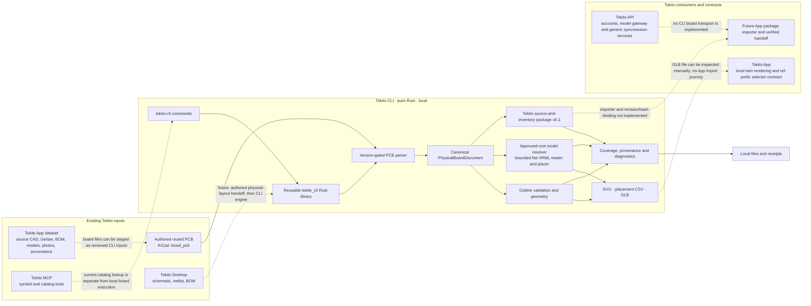
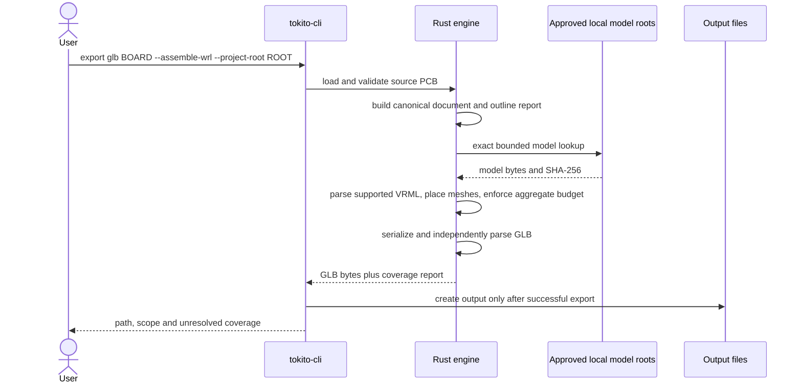

# Tokito CLI architecture

Status as of 2026-10-10. This document describes the implemented Rust CLI and the observed Tokito integration boundaries. Dotted links in the diagram are future work; they are not working integrations.

## System context

The dataset is an input corpus, not a runtime service. Its photos and labels do not by themselves provide verified component-to-photo correspondence or camera registration. The desktop schematic/netlist is not a routed physical board; it cannot produce a physically placed 3D PCB without a layout stage. The catalog MCP does not invoke the local CLI. The App has native twin-rendering and node-prefix selection contracts, but the reviewed snapshot does not expose a board-package import operation.

## How a local export works

1. `tokito-cli` dispatches a command to the public Rust library. The library can also be called directly by another Rust program; it does not start a server or require an account.
2. The importer accepts only reviewed KiCad PCB format dates. It records source identity and parser diagnostics in a canonical `PhysicalBoardDocument`; unknown or unsupported physical features are not silently promoted to complete geometry.
3. Inspection and placement output read the canonical model. SVG uses supported authored board geometry and is labelled partial. Physical outline validation is a separate fail-closed gate for shell and 3D export.
4. GLB export triangulates/extrudes the validated outline. By default it refuses a partial shell. `--allow-partial` is explicit consent to emit incomplete output.
5. `--assemble-wrl` additionally resolves model paths only beneath user-approved local roots, parses the bounded VRML97 Group/Transform/scene DEF/USE triangle and validated planar-polygon mesh profile, and places accepted meshes from authored transforms and supported stackup planes. `.wrl` and `.vrml` extensions are accepted; negative-scale reflections repair triangle winding. `--component-filter` applies observed KiCad 10.0.5 ASCII `*`/`?` reference patterns before resolving model paths, with one bounded board-wide work budget. `--no-dnp` excludes source footprints carrying KiCad's native `attr dnp` marker. Each uniquely identified component is one renderable glTF node named `ref:<reference>`; that node owns a mesh with separate primitives for its imported model parts and carries UUID/source metadata. This matches the App's exact prefix-plus-reference visibility filter. CLI subprocess tests cover the structure and selection rule; App package intake and Android rendering/selection remain untested.
6. The report identifies each unresolved model and reason, within a bounded report size. STEP, broad VRML97, glTF/GLB input, inferred/proxy models and network model downloads remain unsupported. An incomplete assembly is refused unless `--allow-partial` is present.
7. The v0.1 package preserves source and inventory with hashes. It does not yet contain the generated render views or satisfy the App import contract.

## Implemented Rust boundaries

| Module | Responsibility |
| --- | --- |
| `src/main.rs`, `src/cli.rs` | Executable entry, command/help dispatch, input/output argument validation and exit behavior. `pcb` is a discoverability alias for existing board commands. |
| `src/lib.rs`, `src/document.rs` | Public library API, canonical typed PCB records, physical stackup and derived inventory. |
| `src/geometry.rs` | Supported partial SVG projections from imported board geometry. |
| `src/topology.rs` | Physical outline connectivity, contour/cutout classification and fail-closed topology diagnostics. |
| `src/model_resolver.rs` | Exact model-path lookup under caller-approved local roots, bounded file reads and content hashes. |
| `src/model_mesh.rs`, `src/component_pose.rs`, `src/model_assembly.rs` | Bounded VRML triangle parsing, supported transform placement, identity checks and an aggregate geometry cap. |
| `src/glb.rs` | Board-shell and supported VRML assembly serialization, one mesh-bearing selector node per component, structured coverage report, container-size cap and Rust glTF validation. |
| `src/package_input.rs`, `src/strict_json.rs` | v0.1 source/inventory package input and strict manifest parsing/verification. |

This is one Rust crate with a public library and a thin binary. Proposed future workspace crates are not current APIs and are intentionally not shown as implemented components.

## Trust, completeness, and integration rules

- Model resolution reads no ambient search path and makes no network request. Only explicitly configured roots and variables participate.
- Source model hashes and source component identities are retained. Local absolute model paths are not copied into GLB coverage metadata.
- Unknown or unsupported source geometry must remain diagnostic. A coverage-complete supported-model assembly still does not certify copper/artwork completeness, mechanical fit, manufacturing correctness, image registration, AR guidance, or phone import.
- The Rust selector node name follows the App's documented prefix-plus-reference convention. UUID remains in node metadata to preserve source linkage, but the App consumer currently requires refdes-based node names.
- Desktop-to-engine transport, a physical board layout handoff, MCP execution, App package installation, API upload/sync of board artifacts, and phone/device acceptance are not implemented by this repository.
- Pure Rust applies to this CLI's dependency and runtime boundary. It does not imply every upstream Tokito product uses the same dependencies.

## Next architecture gates

1. Independently compare asymmetric top/back, non-zero model transforms and mesh bounds against a reviewed KiCad/mechanical output; installed KiCad is 10.0.5, and 10.0.7 parity is not established.
2. Qualify more real model-library assets and source boards, then add a tested pure-Rust STEP reader/tessellator only after a pinned corpus demonstrates useful coverage.
3. Define one versioned physical-layout handoff from Desktop. Schematic connectivity and BOM alone are insufficient input to a physical board mesh.
4. Agree a package/import contract with the App owner, including source revision, GLB digest, coordinate frame, component mapping and registration evidence; verify it on a real device before claiming interoperability.
5. Add local MCP/Desktop adapters only over the stable library/job contract. Keep existing hosted symbol catalog and API authorities separate.

Related detail: [canonical engine](CANONICAL_ENGINE.md), [native format architecture](NATIVE_FORMAT_ARCHITECTURE.md), [GLB export](GLB_EXPORT_ARCHITECTURE.md), [model resolution](MODEL_RESOLUTION.md), [App/API bridge audit](APP_API_BRIDGE_AUDIT.md), and [ecosystem contract map](ECOSYSTEM_CONTRACT_MAP.md).
