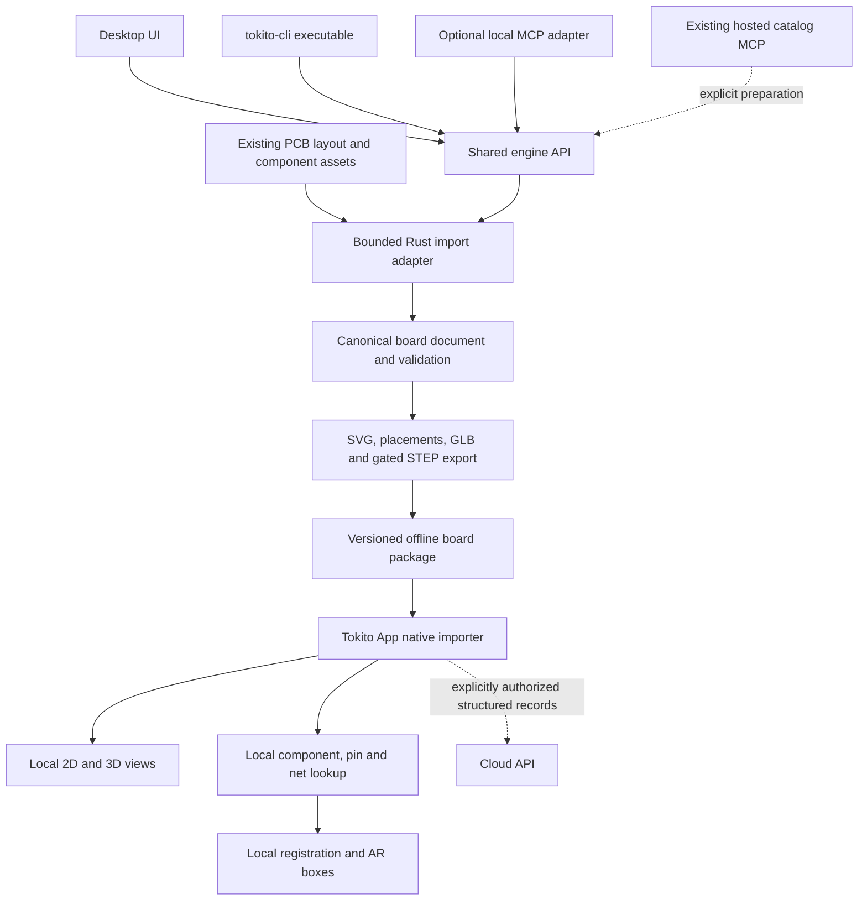

# Tokito CLI architecture and roadmap

Date: 2026-10-10. Status: Milestones A and B provide the reusable canonical Rust PCB document and fail-closed physical outline/topology API. Milestone C is active on `codex/milestone-c-selectable-glb`; its first slice builds a board shell only and must not claim component selection. See [native format contracts](NATIVE_FORMAT_ARCHITECTURE.md) and [GLB export architecture](GLB_EXPORT_ARCHITECTURE.md) for current input, frame, coverage, and model-resolution decisions. The desktop, MCP, phone, and AR integrations remain later work.

## Confirmed scope

The owner confirmed a private `TokitoAI/tokito-cli` repository, original Rust implementation, pure Rust dependencies, and no KiCad CLI invocation. KiCad application source is a behavior/format reference, not code to copy or translate. Existing PCB import comes first; schematic-to-PCB generation is later.

The CLI is a new engine boundary, not a second Desktop or mobile application. Keep existing product repositories and storage authorities. The current Android runtime may continue to use its existing native dependencies; the pure-Rust requirement applies to this new CLI and its dependencies.

## Proposed topology



This is a **future design**. Current hosted MCP is catalog-only; current Desktop/mobile have no implicit live bridge. Package exchange makes data portable without sharing either product's database or editor session.

## Crate responsibilities

Names below are proposals, not existing APIs.

| Crate | Responsibility | Excluded responsibilities |
| --- | --- | --- |
| `tokito-board-contract` | Versioned IDs, units, geometry, board/package/job DTOs, capability declarations and compatibility | UI, database, network and CAD algorithms |
| `tokito-board-core` | Canonical physical document, validation, transformations, spatial/semantic indexes | Schematic routing and GUI projections |
| `tokito-kicad-format` | Bounded PCB/footprint parsing, source provenance and import diagnostics | Launching KiCad or importing unknown formats by guess |
| `tokito-board-export` | Layer SVG, placements, board mesh and component-preserving GLB | Independent reinterpretation of placements |
| `tokito-cad` | Optional pure-Rust STEP parsing/modeling/tessellation/export behind an explicit capability gate | Claiming arbitrary STEP compatibility without corpus evidence |
| `tokito-board-package` | Manifest/artifact integrity, portable payload, atomic writing and inspection | Model distribution or arbitrary filesystem access |
| `tokito-cli` | Thin command-line interface, progress, exit status and structured job results | Hosting an AI agent or requiring Cloud authentication |
| `tokito-cli-mcp` | Optional local typed MCP job adapter over the same engine | Changing the public catalog into a local machine executor |

Desktop can link published/tagged engine crates for short operations. Large or failure-prone jobs can run in a local subprocess using the same contracts, without shell command construction. Version pins must be explicit. Do not use machine-specific path dependencies in committed production manifests.

Do not depend on the entire current `tokito` or `tokito-catalog` crates merely to access formats: these bring database/network/native dependencies into the pure-Rust graph. Existing MIT parser/model logic can be extracted behind a minimal crate with coordinated call-site changes. Reuse `tokito-schematic-core` as schematic authority when that stage arrives; do not treat its schematic drawing coordinates as PCB dimensions.

## Source import

First source adapter: declared versions of `.kicad_pcb`, including embedded footprint geometry. The v0.1 Tokito package currently preserves the source plus inspection and placement inventory. It is not the canonical geometry-complete interchange model. Future package versions may align with the mobile app's digital-twin manifest and assembly-context contracts after the engine can produce the required geometry and an app import journey is verified. Do not assume those two mobile contracts already form a complete board package. Footprint-only libraries and external model paths are separate resolvers. Eagle, Altium, boardview and Gerber remain later adapters, each with a declared capability/loss contract.

Import must identify:

- Exact source format/version, source SHA-256, board identity/revision and importer version.
- Closed board outline and cutouts, thickness/layer information when actually present.
- Footprint UUID/library ID/reference/value/side/anchor/rotation and schematic path.
- Pads, holes/slots, pin numbers, nets, local geometry and transformed physical positions.
- Authored footprint body/courtyard/assembly geometry, separately labelled by evidence quality.
- Model paths, file types/digests, offsets/scales/rotations and missing/hidden model status.
- DNP/exclude-from-BOM/exclude-from-placement distinctions; inspection inventory must not silently lose excluded parts.

Every geometry-affecting construct must be supported or explicitly diagnosed. Preserving raw unknown syntax does not establish semantic support. Partial import may be useful for viewing, but it must carry a machine-readable completeness state and must not pass the acceptance gate for a faithful twin.

Do not silently close broken outlines, assume board thickness, map a symbol name to guessed component dimensions or download referenced files. Explicitly authorized resolution uses a bounded workspace/cache and records provenance. Reject unresolved scale, nonfinite/out-of-range values, duplicate identities, inconsistent references and unsafe asset paths.

The alpha `kiutils-rs` parser is a candidate, not a selected dependency: it carries placements/pads/models but only counts some footprint/custom-pad geometry. The existing Tokito S-expression parser is another reuse option after extraction and resource-limit work. Compare these in a real input spike rather than create a third unreviewed tokenizer.

## Canonical board document

Proposed representation:

- Explicit schema major/minor and source revision/digest.
- Integer physical coordinates with a named unit, recommended nanometres; conversion precision and rounding errors are explicit.
- Declared origin, axes, handedness and top/bottom conventions. Import/export each owns an explicit transform to this frame.
- Stable board, footprint-instance, pad and net IDs. Preserve source UUIDs where meaningful, namespaced by source/board identity.
- Source schematic instance UUID and pin-key linkage when provided. Refdes is a searchable label; it is not sole identity.
- Outline, cutouts, stack/thickness, footprint and pad geometry, source model transforms and per-component render selectors.
- Geometry/electrical evidence, missing fields and diagnostics separated from observed camera/session data.

Exact net/pad identities matter more than display names. Two pads named GND remain separate physical pins. Renaming D1 must preserve component identity. Board revision changes create a new package revision rather than mutate installed immutable geometry.

Design truth, rendering derivatives and physical observations remain distinct:

1. Imported layout states where a component/pad belongs.
2. SVG/GLB are derived renderings with traceable identities.
3. Camera detections and measurements are timestamped observations with uncertainty.

A visual model or datasheet sentence must not overwrite authored placements.

## Export behavior

### SVG and placements

Generate front/back and requested layer views directly from the canonical document. Bottom mirroring is a view transform, never a rewrite of canonical coordinates. Retain component IDs, pad/net IDs and view-to-board transforms for selection.

Placement output must declare units, origin, axis directions, side and rotation convention. Distinguish footprint anchor, assembly/pick centroid and inspection bounds. Offer different exclusion/filter profiles explicitly; do not infer them from file extension. Manufacturing-ready CPL requires the relevant centroid/polarity evidence and exporter profile tests.

### GLB

The first implementation produces a board-shell-only GLB from validated outline/cutout geometry and authored board thickness. It is always labelled partial and requires explicit `--allow-partial`, including boards with zero footprints. GLB is the phone render artifact; STEP is the engineering solid interchange artifact. They are separate representations.

Normalize GLB to the existing app convention: metres, right-handed Y-up, board plane XZ/height Y. Store the exact board-to-GLB matrix in the package and test it. Never apply mm-to-metre scale twice.

The shell-only slice has no component selectors. Its JSON coverage report lists unresolved source components and their raw model-reference paths with explicit truncation status. The next model phase must keep one stable semantic component identity even when a component has several mesh nodes. Every renderable selector must map to its component ID. Initially support the current `componentNodePrefix + refdes` consumer through a validated adapter; migrate Android to explicit component-ID selectors before relying on UUID names.

Missing component models must be visible in a coverage report. The current shell output is partial by definition; later assembled export must fail by default when any component body is unresolved. Any future partial assembly also requires explicit opt-in and remains labelled partial. It must not become an apparently complete twin or a fabricated replacement component. Initially exclude unsupported mesh compression/extensions rather than introduce a hidden native decoder.

### STEP

Pure-Rust Truck/`ruststep` is a research candidate, not a verified replacement for KiCad's CAD exporter. Actual input/output/assembly code exists, but partial conversions and unproven input unit handling prevent a general compatibility claim.

Before exposing STEP as supported, require a corpus of real component models with millimetre/metre/inch units, assembly transforms, multiple data sections, analytic/NURBS surfaces and unsupported entities. Verify face/solid completeness, bounds and physical measurements. Reject failed/partial conversions explicitly. Keep SVG/placements and supported GLB output available independently of STEP.

## Portable board package

Proposed logical contents, with names to be finalized by contract work:

```text
manifest.json
board.json
components.json
views/top.svg
views/bottom.svg
models/board.glb                 optional, qualified by coverage
models/board.step                optional, gated capability
context/reviewed-facts.json      optional cited facts/polarity guidance
registration/landmarks.json     optional measured correspondences
provenance/sources.json
provenance/notices/...
reports/import-diagnostics.json
reports/model-coverage.json
```

Manifest owns schema version, board/revision/source identities, engine version, artifact paths/digests/sizes, transforms, semantic mappings and capability/completeness state. Cryptographic content hashes are distinct from Desktop's non-cryptographic edit-revision hash.

Resolve the existing assembly JSON schema/Rust DTO/Android board-reference mismatch in a dedicated versioned migration. Prefer one dependency-minimal contract crate plus generated schemas and language adapters with shared valid/invalid fixtures. Do not share Desktop or Cloud storage implementations with mobile.

Phone import uses Android's document picker and a native bounded, transactional installer. Validate container paths/entry count/size, schema compatibility, integrity, dimensions, identities and model coverage before publishing the package. Activate only after verification; retain a known valid package on import failure. Storage quotas and any signature/trust policy must be explicit. Hash integrity alone does not identify a publisher.

Existing phone budget of 64 MiB GLB/64 KiB twin manifest is a compatibility constraint, not a promise that every generated package fits it. Package-level quotas need explicit definition and tests.

Each bench session binds to installed package digest + board revision + optional project/design/context revision. Never let switching projects silently reuse an unrelated `active.*` file. Multiple board revisions can coexist with deliberate selection.

## PC and phone division

| Operation | PC now | Phone primary behavior |
| --- | --- | --- |
| KiCad/source import and geometry conversion | Rust CLI/shared engine | Consume verified package; future conversion evaluated separately |
| STEP tessellation and large model preparation | Explicit bounded job | Render admitted GLB offline |
| Source/model acquisition | User-selected/prepared files and recorded cache | No runtime model download requirement |
| Component/refdes/pin/net lookup | Index creation and validation | Local indexed search and ambiguity resolution |
| 2D/3D views and cross-highlighting | Preview/export parity | Local view switching, layers and component focus |
| Board registration and camera AR | Prepare measured landmarks | Local camera/pose/confidence/loss handling |
| Voice/dialogue/measurement | Package preparation only | Local inference, confirmations and durable records |
| Project/session sharing | Optional versioned Cloud | Explicit per-record consent; offline functions remain usable |

Heavy PC preparation is acceptable today. It must not turn ordinary phone inspection into a remote job or require a running laptop. Do not promise that a desktop CAD graph will fit Android performance until measured.

## Component localization and AR

Initial request example: “Where is D1?”

1. Local resolver selects the installed board/revision and exact component ID; ambiguous diode requests ask for a reference or highlight several candidates distinctly.
2. Read authored footprint/body bounds, pads, polarity evidence and source references from that package.
3. Obtain a current board-to-camera transform from verified correspondences. For a planar box, project footprint corners through a homography.
4. Draw the rotated projected box, identity/polarity cues and uncertainty only while registration remains admitted.
5. Clear both 2D and 3D layers on expiry, lost tracking, side/revision mismatch or failed revalidation.

This planar feature does not require stereo triangulation. Height-aware 3D rendering requires calibrated camera intrinsics, metric pose, model transforms and temporal alignment. Reuse existing metric-pose/projection code and wire it into the actual product host before creating another pose path.

Manual corner registration is a useful fallback. Printed marker registration is a separate evaluated option; no marker detector is currently adopted into the pure-Rust CLI. Generic board detection helps acquisition, but cannot by itself prove that a visually similar board or repeated component is D1. Polarity guidance must abstain when reviewed evidence is absent.

Acceptance must report physical alignment error, identity/orientation accuracy, latency/frame pacing, memory, thermal stability, tracking loss/reacquisition and network-blocked operation on the actual phone/board revisions. Populated-board localization does not prove loose-component assembly inspection on a bare PCB.

## CLI and MCP job contract

Current v0.1 commands and planned extensions:

```text
tokito-cli inspect board.kicad_pcb --json
(planned) tokito-cli validate board.kicad_pcb --json
tokito-cli export svg board.kicad_pcb --side top --output top.svg
tokito-cli export placements board.kicad_pcb --output placements.csv
tokito-cli package build board.kicad_pcb --output package-directory
tokito-cli package verify package-directory --json
tokito-cli inspect package-directory --json
```

Jobs identify input digest, engine/schema version, options and allowed output root. Emit structured progress/diagnostics/results with artifact digests. Use explicit cancellation and budgets; write temporary outputs and publish atomically. Never infer success from a process exit code if completeness checks fail.

A future local MCP adapter exposes typed inspect/validate/export/package jobs over the same engine. Do not pass arbitrary shell strings or unrestricted paths from model/tool input. Long jobs return bounded job identities and typed state rather than blocking the public catalog's five-second requests.

Hosted agents cannot directly execute a local stdio server. If future Cloud AI requests a PC job, Desktop receives a typed proposal, checks local authority/path scope and invokes the local engine. The phone does not depend on that link.

Strict pure-Rust dependency verification applies to resolved runtime and build dependencies, compression/image/crypto backends, and transport feature choices. Ring, aws-lc, native SQLite, OCCT, zlib/other native codecs and unexpected `*-sys` dependencies must be detected rather than assumed absent. OS APIs/compiler runtime are a separate platform boundary. Select transport implementation only after this audit; no existing HTTP/MCP crate is automatically approved.

## Implementation gates

| Stage | Observable completion | Required evidence |
| --- | --- | --- |
| Contract | One compatible board/package schema with phone migration plan | Cross-language valid/invalid fixtures, exact units/ID/transform tests |
| Import | Real existing boards import without silent geometry loss | Rotated/front/back/custom-pad/hole/outline/net/model corpus; malformed/resource-limit tests |
| SVG/placement | Outputs agree with the imported canonical board | Numeric bounds/rotation/unit checks and visual artifact inspection |
| GLB | Components retain identity, size, side and transforms | Renderable selector coverage, real model bounds, missing-model reports and viewer inspection |
| STEP | Only supported solid/model families advertised | Real unit/assembly/surface/completeness interoperability corpus |
| Phone | Offline import/view/search/box flow reachable | Network-blocked actual-device journey, wrong-revision/corrupt-package negative paths |
| AR reliability | Correct calibrated pose and all layers invalidate | Held-out captures plus motion/occlusion/loss/reacquisition and sustained thermal measurements |
| Desktop/MCP | Same engine results through each adapter | Contract fixtures and real local integration journeys |

Repository preparation/documentation does not satisfy any implementation gate. No production dependency is selected solely because its README lists a capability.

## Remaining input

Exact product target-board revisions remain undecided. [Four pinned fixtures](PCB_FIXTURE_CORPUS.md) now exercise real KiCad 8/9 files and routed designs, with community Pico/UNO conversions and NXP MCXA ESC coverage. They do not certify those board families. The supplied dataset still has no actual PCB/photo/label samples.

Recommended initial transfer is offline package file import; Cloud distribution is a later opt-in feature. Signature/publisher policy, supported format versions, import budgets and numerical acceptance targets must be specified before dependent implementation.

Workspace-only evidence: [ecosystem analysis](../../docs/ECOSYSTEM_ANALYSIS.md), [source research](../../docs/SOURCE_RESEARCH.md), and [analysis ledger](../../docs/ANALYSIS_LEDGER.md). These links require the sibling ecosystem workspace and are not part of a standalone CLI checkout.

Portable primary-source references: [current Desktop boundaries](https://github.com/TokitoAI/tokito/blob/e25ba7b2783f002318be07a9287a2476a1d19bff/docs/PRODUCT_BOUNDARIES.md), [current mobile architecture](https://github.com/TokitoAI/tokito-app/blob/293df87231005c6afd56ced918d09b049cc676bb/docs/ARCHITECTURE.md), [KiCad PCB format](https://dev-docs.kicad.org/en/file-formats/sexpr-pcb/), [pinned parser source](https://github.com/Milind220/kiutils-rs/tree/2cc2e5ab95e6b3b7823c672628e717f3bf3f7a51), and [pinned Rust CAD source](https://github.com/ricosjp/truck/tree/88ed005249e5e3a6b07f62425399435905cd3ab6). Dependency adoption still requires the gates above.
