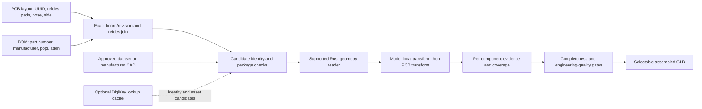

# BOM-driven component geometry and validation

Status: bounded NXP JSON / ESP32 CSV adapters and exact identity reconciliation
are implemented locally. Reviewed model assignments and per-component engineering
acceptance remain future work. The current exporter has model-reference coverage
and a bounded VRML assembly path. This document does not certify a populated board.

## Inputs and ownership

Use `tokito-app-dataset` at an immutable commit as the primary offline corpus.
Never replace its sources with `devboard_ar_dataset`. Manufacturer/distributor
lookups are optional desktop-time enrichment; generation must work from cached
approved assets without network access. No credential is required for initial
dataset-only development.

The inspected MCXN236 `structured-rev-c/bom-items.json` preserves source hash,
spreadsheet row, `reference_designators`, `source_columns.MFG`,
`manufacturer_part_number_text`, `dnp_explicit`, quantity and assembly options.
Its first item represents mounting holes with no orderable part number. Such
items must be classified explicitly rather than counted as missing 3D bodies.
ESP32 `community-clone/structured/bom-components.csv` contains footprint index,
value, footprint name and reference, but no manufacturer part number or pose.
The clone must remain distinct from a verified photographed board revision.

Additional pinned dataset observations: MCXN236's component index has 391 unique
references; 63 DNP and 37 `NO PART TO ORDER` records require explicit population
classification. Its 387 nonempty part-number texts include descriptive jumper
text, so nonempty is not equivalent to an orderable MPN. Ultimainboard has 574
unique PCB/schematic references; 360 records have nonempty `Mfg code`, but 258
are the literal `-`, leaving only 102 candidate part numbers. Candidate numbers
still require exact identity/package verification. These counts are dataset
observations rather than verified physical assembly populations.

A PCB footprint is pad/land-pattern geometry and associated local origin; a
component body is a separate 3D model. The BOM identifies parts and population,
while PCB/placement data identifies X/Y, rotation and board side. Neither BOM
value nor a supplier's package label supplies a trustworthy placed board model.

## Resolution flow



Expand grouped BOM reference lists using preserved source fields, checking
duplicate references, quantity discrepancies and ambiguous variant/population
options. Join to unique PCB refdes and UUID within one exact board revision.
Missing rows and conflicting part numbers remain unresolved; no value-only
automatic substitutions. Footprint library names are candidate package evidence,
not equivalent manufacturer part numbers.

Prefer authored model references in the layout and reviewed dataset mappings.
For missing models, use exact manufacturer plus MPN lookup, then verify package,
pin count, pitch, body dimensions, polarity/pin-one and model origin. Record URL,
asset SHA-256, source revision, units and approval evidence. A parametric model
may be generated only from explicit reviewed dimensions and package geometry;
generic boxes cannot be admitted as faithful component bodies. Generated models
must retain their generated provenance and separate qualification status.

DigiKey's documented Product Information V4 ProductDetails and Media operations
provide product information/media lookup. Their existence is not proof that each
part has a downloadable footprint or STEP asset. Do not promise universal CAD
availability or build a network dependency into the offline export path.
Source: https://developer.digikey.com/products/product-information-v4/productsearch

## Per-component evidence contract to implement

Each PCB identity receives one report row: board/revision, UUID, exact refdes,
BOM source row/hash, manufacturer/MPN, population state, footprint source,
model source/hash, source units, model-local scale/rotation/offset, board X/Y,
rotation and side, derived mounting plane and composed transform, GLB node name,
emitted mesh count, diagnostics and qualification evidence references.

Keep separate states for identity matched, asset resolved, geometry understood,
mesh emitted, placement compared and engineering geometry qualified. A resolved
file is not proof of a rendered body; an emitted body is not proof of correct
geometry or alignment. DNP/nonphysical/mechanical classifications require source
evidence. Unknown assembly options remain unknown rather than silently omitted.

## Acceptance checks

- Every expected populated component is represented by a unique mesh-bearing
  `ref:<refdes>` node and its source UUID; ambiguous identities block completion.
- Parse units and apply local transforms, then footprint pose and side in the
  declared board frame. Compare independent asymmetric landmarks for rotation,
  signed scale, back-side mounting and model offsets.
- Verify mounting-plane height, reference pin/pad alignment, body dimensions and
  polarity. Courtyard/body overlap is a diagnostic, not universal rejection:
  authored overhangs and connector housings can be intentional.
- Check topology, face/instance coverage, winding, normals and sampled geometry
  against independent references with declared tolerances. Surface-count parity
  and AABB alone cannot qualify CAD. Current STEP experiments fail this gate.
- Reconcile BOM, PCB, model references and emitted components independently.
  Report expected/physical/excluded/unknown counts with reasons for every gap.
  A truncated detail report retains correct totals and cannot imply coverage.
- Refuse complete export when required models or qualification evidence are
  missing. Explicit partial export reports its unresolved components and remains
  labelled partial; it never becomes a certified whole-board digital twin.

Model-assignment manifests and explicit partial selectable WRL bodies are now
implemented locally; see [their contract](MODEL_ASSIGNMENTS.md). Independent
geometry/pose acceptance remains pending. Production STEP work remains separately
gated by [dataset geometry evidence](DATASET_STEP_QUALIFICATION.md).

## CLI reconciliation interface

```text
tokito-cli bom reconcile board.kicad_pcb --bom bom-items.json --format nxp-json --json
tokito-cli bom reconcile board.kicad_pcb --bom bom-components.csv --format esp32-csv --json
tokito-cli pcb bom reconcile board.kicad_pcb --bom bom-items.json --format nxp-json
```

This command emits JSON even when `--json` is omitted. A successful process means
the reconciliation report was produced, not that all identities matched or that
the assembly is complete. A resource-cap refusal emits its JSON report and exits
nonzero. The report retains source hashes and separate conflict
counts; model, pose, geometry, manufacturer-part and board-revision qualification
remain false. Use the explicit format adapter rather than guessing from file
extensions. Local acceptance results must be recorded before this interface is
treated as delivered functionality.

The first actual MCXN236 run matched 391 BOM identities from 96 rows and reported
190 anonymous imported footprints with empty references. These are identity
issues, not 190 identified components missing from the BOM. Its board/revision and physical/model
qualification flags remain false. The first ESP32 run exposed a UTF-8 BOM marker
in the dataset CSV; the header parser initially refused it. Encoding-marker
support and a subprocess regression were added rather than rewriting dataset
files. Original-byte SHA-256 remains the source fingerprint. Current-source
full verification is required before push. The corrected actual dataset run
matches all 24 ESP32 BOM references; the two additional references are `REF**`
and `G***` placeholders requiring classification. Both source-pair runs verify original-byte hashes and preserve every
reference; neither asserts model, pose, geometry or board-revision qualification.
The corrected receipt is
`target/dataset-intake/bom-qualification-1791608702596686300/receipt.json`, using
the delivered executable from the successful fifteen-gate run at
`target/delivery/local/20261010T050440Z-26878073a5b347fbb11e7427163d927e/verification.json`.
The final post-verification narrative clarification changes only documentation;
code, tests, manifests and scripts retain their verified fingerprints.
