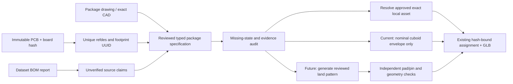

# Component Forge architecture and current slice

Status: prototype in progress. This adds a bounded operation to the existing Rust CLI; it does not replace PCB import, model assignments, or GLB export.

## Decision

Reverse-engineer observable *workflow patterns* from KiCad's package generators: explicit input parameters, repeatable geometry construction, deterministic serialization, and validation of the output. Tokito's implementation is original Rust. Do not port KiCad source or claim a complete `kicad-cli` replica from this work.

Treat four conditions as separate records: an external footprint library file is missing; a schematic part has no physical board footprint; a placed PCB footprint has no 3D body; or an existing/generated asset lacks engineering qualification. The FRDM-MCXN236 U11 example is the third case: its imported footprint has pads 1–9, including custom pad geometry, while the PCB has no U11 model reference. It is not a missing-footprint case.



## Implemented command

```text
tokito-cli component model envelope SPEC.json --board BOARD.kicad_pcb --output BODY.wrl --json
```

The versioned `tokito.component-envelope.v1` parser rejects duplicate/unknown keys, malformed hashes/commit IDs, unsupported schema, invalid dimensions, and a board hash or unique reference/UUID mismatch. It produces a deterministic 8-vertex, 12-triangle, flat VRML cuboid. Dimensions are nominal millimetres. The resulting file can pass through the existing assignment and GLB paths, where existing partial-export rules still apply.

The PCB identity is checked. Dataset commit, BOM digest, manufacturer, MPN, package name, and URL remain claims in the specification; the generator does not open or authenticate those sources. The report labels the output `candidate-envelope-only` and marks BOM matching, package fit, physical board revision, placement, terminals, pin-one detail, and footprint generation false.

## Evidence-specific behavior

The actual FRDM-MCXN236 U11 run verifies the pinned dataset commit, imported PCB hash, BOM report's U11 join, and unique board identity, then generates a nominal 3 × 3 × 0.85 mm candidate envelope. The generic resistor-fixture E2E additionally proves that a dimension-matched envelope can be assigned and emitted as one selectable partial-GLB component node.

The U11 dataset E2E does **not** emit U11 in the board GLB. The imported PCB lacks a canonical stackup object, which is a confirmed placement blocker; the current exporter reports the combined `missing_stackup_or_outline` condition, so the test does not prove stackup is the only unmet condition. Although a related generated Gerber job contains stackup metadata, no qualified adapter binds it to this PCB hash. The E2E therefore validates fail-closed shell-only output.

## Current App handoff target

The latest read-only `TokitoAI/tokito-app` main snapshot is `780f3fbef5e0c207c736b7ad4ab9a28f3e15ec50`. Its checked-in `physical-runtime/schemas/digital-twin.asset-manifest.schema.json` and `physical-runtime/docs/DIGITAL_TWIN_AR.md` define the package target: a GLB capped at 64 MiB, SHA-256 and byte-length binding, metre units, right-handed Y-up axes, board origin/bounds, board identity/revision, assembly-context revision, opacity, and a component-node prefix such as `ref:`. The documented runtime selects components using that prefix and reference designator.

The live app repo also has open PR #78 (`e9e85dae9bda50ac93546b3275821716ac52e1ac`), a component-camera smoke harness. It returns class labels and image-space boxes; it does not consume a GLB, register a board, or identify a reference designator. Open draft PR #72 (`3d8a17c99afd1b0cdaf99157a1720403c0e0579d`) requests private schematic-symbol drafts from a registered board context; it is not a footprint or component-model path and currently has merge conflicts. Neither branch changes the CLI's main-branch contract. Treat any detector box as a visual candidate, never as a refdes/model identity join.

The current CLI GLB writer already uses metres and a right-handed Y-up frame, and the component-assembly fixture emits a `ref:<designator>` node. Tokito CLI does not yet emit the App manifest, glTF per-node identity metadata, or an App-accepted immutable assembly-context revision. Those are explicit integration gaps; matching axis names alone does not establish App compatibility. The manifest's context and board identity must come from the authoritative project/dataset package, not be invented by the exporter. App documentation is a contract target, not independent proof of the described on-device behavior.

## Dataset model inventory boundary

The dataset `main` snapshot is `257ea7e68ee2e700522bd1b19ad9cbf1c0c3980a`, identical to the local pinned intake. Its materialized local artifacts include a 506 KB FRDM-MCXN236 board-only STEP and 61 Ultimainboard extracted STEP streams (39 unique content hashes), plus a 280 KB Ultimainboard board-only STEP. The board-only GLB/STEP pointers for some boards are not usable geometry until their LFS objects are materialized. These are source candidates, not automatically component assignments.

Dataset PR #7 is still an open, unmerged evidence update at `ae27af81ccaf3a21a4127341a2244bfd48c2503c`. It adds a 574-row refdes/footprint-UUID crosswalk scoped to one imported PCB hash, plus model references and extraction provenance. It reports 310 imported KiCad model references and 264 PCB references without an imported model reference. The 61 numbered embedded Altium STEP streams have only 39 distinct hashes and are not associated with those refs; the assembly model's photo match is unverified. The STEP, assembly-GLB, and board-only files are present in the dataset's LFS-backed source tree, but the #7 changes add evidence metadata rather than those CAD binaries. Use the UUID crosswalk to bind inventory; do not assign a numbered STEP stream by its extraction index or silhouette.

Dataset PR #6 is also open at `ab1420fb08e813d4c761c6454fbba16cceaaa5dc`. Its NXP component map has 391 refdes rows and 354 GLB selectors. The map and manifest point to a separately released 5,250,580-byte GLB; the files are not committed in the dataset PR itself. The exact-hash asset was materialized under ignored `target/dataset-intake/pr6-mcxn236-ab1420fb/` and independently checked: 354 unique `ref:` selectors each resolve to an isolated mesh subtree. The source map labels 306 bodies `exact_package_geometry`, 25 `verified_package_approximation`, 23 `dimension_accurate_placeholder`, and 37 references without a body. These are source quality labels, not Tokito physical-fit qualification. The PR provenance explicitly leaves the photographed specimen revision, fitted BOM, and visual detection accuracy unverified. Its map has no footprint UUID or imported-PCB SHA, so a hash-bound join is still required before production assignment.

The MCXN236 U11 remains a model-gap example, not a footprint-gap example: the imported PCB has pads 1–9, and the dataset PR #6 map names `ref:U11` with a package-approximation body candidate. Do not silently promote that candidate into the current imported PCB; its map lacks the footprint UUID/PCB-hash crosswalk required by Tokito's assignment manifest.

## Next implementation sequence

1. Keep the current envelope as a candidate-only body primitive.
2. Build a separate evidence/audit record that distinguishes missing footprint source, unassigned physical footprint, missing 3D body, and unqualified body. Bind rows to board hash, footprint UUID and reference where source evidence provides them.
3. Reuse dataset models only through evidence-backed joins. PR #6's NXP asset is a reference for selector/model coverage; PR #7's Ultimainboard UUID map can bind the imported PCB, but the extracted 61 STEP streams still need a reviewed stream-to-ref crosswalk.
4. Select a true missing-footprint case only after the pinned dataset audit finds one. For an initial package family, store min/nominal/max values and the package drawing's revision/hash, pin map, view convention, and complete land-pattern semantics.
5. Generate an independent Rust footprint geometry tree and deterministic `.kicad_mod` serializer. Compare pad numbers, dimensions, positions, mask/paste, pin-one, courtyard, and bounds against the manufacturer drawing and a pinned reference; preserve the source PCB.
6. Add sourced terminals/body details to the mesh generator only when package geometry supports them. Continue to use the existing assignment and GLB path, with identity, geometry, placement, and qualification statuses kept separate.
7. Add the App's manifest and node-metadata handoff only after the CLI can provide authoritative board identity, assembly-context revision, GLB bounds, and byte/hash values; validate against the checked-in App schema without editing the App repository.
8. Evaluate STEP/B-rep libraries only in an isolated experiment after the existing mesh and reference gates establish a concrete need.

Photo processing remains a candidate annotation/overlay aid. A top photograph cannot reveal hidden pads, terminal numbering, or internal body shape and cannot approve a generated asset.

## Current dependencies and boundaries

Production code remains pure Rust and offline. The Rust mesh output is limited to the existing supported VRML triangle profile. KiCad, FreeCAD, Python CAD tools, image processing, and web lookups are optional development/reference tools, never required during local export. Schematic-only inputs still cannot create a physical layout. See [specification](COMPONENT_FORGE_SPECIFICATION.md), [qualification](COMPONENT_FORGE_QUALIFICATION.md), and [upstream review](COMPONENT_FORGE_OPEN_SOURCE_REVIEW.md).
