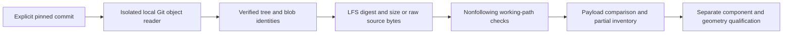

# Immutable Git and LFS dataset inventory

~~~text
tokito-cli dataset inventory <STANDALONE_CHECKOUT> --revision <FULL_COMMIT>
tokito-cli dataset inventory <STANDALONE_CHECKOUT> --revision <FULL_COMMIT> --assets-root <CANDIDATE_ROOT>
tokito-cli dataset bind <STANDALONE_CHECKOUT> --assets-root <CANDIDATE_ROOT> --request <REQUEST.json> --output <NEW_BINDING.json>
~~~

This pure-Rust command reads the specified local commit, not the current branch or index. It verifies the commit, tree and regular blob object IDs, enumerates tracked paths, compares working payloads, and reports per-source materialization counts. It never checks out files, downloads missing Git/LFS objects, executes Git, applies filters, or reads untracked qualification outputs.

## Report and interpretation

Schema: `tokito.dataset-git-inventory.v1`. `status: inspected` means enumeration completed, not that the dataset is usable for AR. `commitAndTreeHashesVerified` means local immutable object identity was checked. `publisherAuthenticated`, `roleAndBoardIdentityQualified`, `physicalFitVerified` and `appAdmissionAuthorized` remain false.

Each asset records its Git object ID, source-folder grouping, filename-derived role claim, LFS digest/size where supported, and payload state. The states are `materialized`, `pointer_only`, `missing`, `content_mismatch`, `unavailable`, `unsupported_mode`, `unsupported_payload_size`, `unsupported_source_pointer`, or `invalid_source_pointer`. Linked paths and metadata/permission errors are unavailable, not missing. Valid LFS extensions are unsupported by this bounded simple-v1 profile; they are not automatically treated as invalid CAD.

`workingTreeCoverageComplete` is true only when every tracked asset's actual content matches. The checker intentionally performs no line-ending or clean/smudge transformation: Windows CRLF conversion can yield a byte mismatch even when text semantics are unchanged. Review the source bytes separately before admitting that transformation. Source-folder and extension labels are inventory clues, not validated board identity or format support. MCXN947 and MCXN236 remain separate source groups.

The existing [source-lock commands](DATASET_SOURCE_LOCK.md) lock selected working payloads independently; they still carry a caller-declared revision. Optional `--assets-root` compares a separately staged tree retaining source-relative paths against the local pinned Git objects. Neither operation copies or downloads files.

`dataset bind` accepts the existing source-request v1 schema and emits `tokito.dataset-source-binding.v1`. Its `contentLock` is an ordinary v1 lock; `sourceAssets` records each selected source blob and supported LFS identity. Every selected path must be tracked at that commit and its actual byte count/digest must agree with both the inventory and content lock. Untracked, altered, missing, pointer-only and unsafe inputs refuse before publishing a receipt. The new output refuses overwrite and is capped at 4 MiB. Use the embedded `contentLock` with `dataset verify` for later listed-payload integrity checks; the binding wrapper itself is not a v1 lock. The wrapper is evidence of local object/payload correspondence, not a signed publisher certificate or accepted engineering package. Board/role claims, physical fit, geometry qualification and App admission remain false.

External release models that are only referenced by tracked provenance are not tracked source blobs. Binding rejects a request to treat them as such; a separate typed external-artifact provenance adapter is still required.

## Storage, limits and dependency

Only a standalone real `.git` directory is supported. Shared gitdirs, alternates, symlinks/reparse points and external storage are refused. Repository-local config is read with a 64 KiB cap; user/system/environment config and includes are disabled. Replacement objects are disabled by an application override. The caller must provide a stable local snapshot; preflight does not protect against concurrent filesystem replacement.

Tree depth is capped at 64; files and trees at 10,000 each; commit/tree bodies at 4 MiB; blobs and working payloads at 256 MiB each. Decoded source and working payload byte totals are capped separately at 2 GiB; stored Git metadata is capped at 2 GiB and 20,000 entries. The report is limited to 8 MiB. The object store has an explicit 256 MiB allocation limit; this is not a total process-memory or CPU sandbox.

The dependency is exact `gix = 0.83.0`, defaults disabled, features `sha1` and `zlib-rs`. Cargo.lock records package checksums; the upstream release tag resolves to [53f880c7604232c367870088176e42efd8a5b783](https://github.com/GitoxideLabs/gitoxide/tree/53f880c7604232c367870088176e42efd8a5b783). The resolved `gix-pack` is 0.70.0, above the affected versions in [the packed-object advisory](https://github.com/GitoxideLabs/gitoxide/security/advisories/GHSA-x494-mj8g-cj27). The normal dependency tree includes Rust zlib and no C zlib/OpenSSL/libgit2 binding. Rust 1.85 compatibility is declared/resolved; testing the minimum compiler remains separate from the current Windows compiler gate.

## QA and remaining pipeline

`tests/dataset_git_e2e.py` uses Git only as an independent fixture/oracle tool. It compares commit/tree/blob identities, verifies LFS payloads, partial/mutated/missing paths, old pins independent of HEAD, replacement suppression, corrupt loose objects, packed objects, linked tracked parents, oversized local config, unsupported pointers, unchanged metadata and untracked-file preservation. Detached candidate binding tests cover raw and LFS payloads, altered/pointer/untracked refusal and no overwrite. The optional dataset journey compares every tracked path/object ID at the pinned main commit and binds three materialized PCB inputs.

A partial clone must have the relevant Git objects present before running the CLI. Preparation tooling may explicitly fetch pinned PR object data into the CLI-owned cache; the shipping inventory command does not do so. Open PRs remain distinct candidate commits. Further stages are selected-asset materialization, reviewed update comparison/admission, source PCB/UUID/refdes/model crosswalk, units/transforms/geometry qualification and physical registration. See [issue #26](https://github.com/TokitoAI/tokito-cli/issues/26) and [the active goal tracker](GOAL_TRACKER.md).
