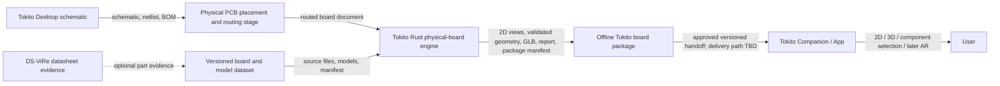

# Tokito physical-board ecosystem contract map

Status: CLI source plus read-only local Desktop and immutable remote App/dataset snapshots refreshed on 2026-10-10. The friends are actively developing App/dataset; conclusions apply only to the commits below, not uncommitted or subsequent work. Sibling checkouts were not pulled or edited.

## Current verified boundary

| Area | Evidence available | Current role and limit |
|---|---|---|
| Tokito Desktop schematic studio | Local read-only snapshot `tokito` at `master`, commit `e25ba7b2783f002318be07a9287a2476a1d19bff`; its README and schematic-editor docs describe schema-v2 schematic documents and schematic, netlist, BOM, SVG/PDF, and MCAD exports. | Schematic-first. The inspected snapshot does not provide routed PCB geometry. Its schematic symbol positions and MCAD handoff cannot establish physical component placement, board outline, stackup, routing, or 3D component pose. Friend's newer Desktop state must be checked at its supplied commit. |
| Tokito CLI / Rust engine | This repository. The prior reviewed source commit `5db49481ce62e859d13cf0504c75f6f6d1124add` was delivered through PR #11. The current selector/help continuation is local and must be verified separately before any delivery claim. | Imports a bounded KiCad PCB subset or Tokito package v0.1; exposes a reusable Rust engine; emits inventory, partial SVG, source-frame placement CSV, board-shell GLB, and an opt-in bounded local VRML assembly GLB. Assembly uses one renderable `ref:<refdes>` node per component with a multi-primitive mesh, UUID/source metadata, bounded coverage diagnostics and explicit partial-export consent. The CLI help tree covers only implemented Tokito commands. App package import, actual Android selection, STEP, complete board geometry and schematic-to-physical conversion remain unimplemented. |
| Tokito App | Remote `main` at `780f3fbef5e0c207c736b7ad4ab9a28f3e15ec50`, inspected read-only via authenticated GitHub CLI. | Docs define an `assembly.context-bundle` v1 and a separate GLB + digital-twin manifest, bound by revision, units/frame, GLB hash/size and component-node prefix. Native selection uses `componentNodePrefix + refdes` (default `ref:`). The mobile JS/native bridge exposes sessions/sync and dialogue/vision/voice model bundles, but no board-package intake or final Desktop-to-phone delivery flow. |
| `tokito-app-dataset` | Earlier corpus `9787b398231421656e64f40217ed7e17e9aac625`; newer Ultimainboard sample `c2bdf2369e13b71aaa8f13a91a23637faf339813`; read-only remote inspection, not checked out locally. | Photo/annotation and CAD/model reference collection with incomplete specimen-to-source mapping. The earlier corpus includes an ESP32 community clone; the newer Ultimainboard sample includes Altium plus a derived KiCad reference. Other families and native Altium/STEP need their own adapters or source/layout evidence. No formal board-package import schema is established. |
| DS-ViRe | Public [Tokito DS-ViRe repository](https://github.com/TokitoAI/tokito-dsvire); its README describes typed, hash-bound datasheet figure evidence. | Useful as an optional evidence source for part identity, package drawings, pinouts and datasheet context. It is not a PCB-layout parser, physical placement authority, 3D model generator, or model-transform validator. Keep it outside the offline geometry-critical path. |
| Tokito MCP/catalog | `docs/ECOSYSTEM_INTEGRATION.md` and read-only `tokito-mcp` snapshot | Symbol/catalog operations may support design-time part lookup. They do not replace the local board importer or provide physical board geometry. |
| Tokito API/cloud | Remote `master` at `e52c0d87f053611ed831fb74ffa186c06d28dc0e`; current docs/API.md and docs/SHARED_PROJECTS.md inspected through authenticated GitHub CLI | Shared sync includes structured `physical_sessions`; Companion exposes generic named artifacts up to 16 MiB. There is no typed board/GLB import, package validation, or CLI binding. Generic artifact storage alone does not install or activate a twin. Cloud remains optional for deterministic local preparation/viewing; see APP_API_BRIDGE_AUDIT.md. |

The `tokito-app-dataset` URL supplied by the user is the relevant target. `devboard_ar_dataset` is a different local folder and remains a research scaffold, not a source of verified product-board geometry.

### Remote refresh evidence and limits

The [dataset coverage report](https://github.com/TokitoAI/tokito-app-dataset/blob/9787b398231421656e64f40217ed7e17e9aac625/docs/sources/COVERAGE.md)
and [source relationships](https://github.com/TokitoAI/tokito-app-dataset/blob/9787b398231421656e64f40217ed7e17e9aac625/source-bundles.json)
distinguish photos from reference CAD. The photo collection has 80 originals/crops
and separately reviewed board boxes; component seeds remain partial, not exact
refdes/BOM identity or qualified component-detector training labels. ESP32 CAD is
a community clone. Ultimainboard 2.1.4 has Altium PCB and embedded STEP component
models, but photo-to-layout registration remains unverified. Pi 3B V1.2 has a
community model without native layout/refdes mapping. The photographed NXP
MCXN236 has no native CAD in that snapshot; MCXN947 design files are explicitly
incompatible and must never be attached to that specimen. Images are perception
evidence, not an authority for physical placement, model units or connectivity.

The newer Ultimainboard sample provides 120 asset records, 61 embedded STEP
models with mixed declared units and 574 UUID/refdes joins. Only J22 has reviewed
photo mapping; model assignments and global registration remain unverified.
Committed metadata was checked; binary/LFS hashes and producer scripts were not
rerun. See [sample audit and intake](DATASET_BOARD_HANDOFF.md).

The refreshed [App bridge](https://github.com/TokitoAI/tokito-app/blob/780f3fbef5e0c207c736b7ad4ab9a28f3e15ec50/apps/mobile/modules/tokito-physical/src/index.ts)
does not expose board-package installation. Its [native twin view](https://github.com/TokitoAI/tokito-app/blob/780f3fbef5e0c207c736b7ad4ab9a28f3e15ec50/physical-runtime/android/ar-runtime/src/main/kotlin/ai/tokito/physical/ar/DigitalTwinView.kt)
looks up prefix-plus-refdes nodes. Future exporters need both UUID identity and
unique validated reference mapping, rather than assuming UUID-only names satisfy
the current App contract. Integrity/signing ownership and shell import remain
integration gates; no phone/device test was run.

The live App docs define two separate artifacts: a revisioned assembly-context
bundle and a GLB with a digital-twin manifest. They describe optional verified
local import, while the root product boundary says cross-product exchange must
use an authorized versioned Cloud contract. The repository does not settle which
delivery path Tokito Desktop should use, identify a final user-facing import
flow, or establish the canonical board/GLB pair and signing owner. Keep the CLI
v0.1 package marked `mobileImportReady: false` until the App owner confirms
those points. See the pinned [assembly-context contract](https://github.com/TokitoAI/tokito-app/blob/780f3fbef5e0c207c736b7ad4ab9a28f3e15ec50/physical-runtime/docs/ASSEMBLY_CONTEXT.md),
[digital-twin contract](https://github.com/TokitoAI/tokito-app/blob/780f3fbef5e0c207c736b7ad4ab9a28f3e15ec50/physical-runtime/docs/DIGITAL_TWIN_AR.md),
and [product boundary](https://github.com/TokitoAI/tokito-app/blob/780f3fbef5e0c207c736b7ad4ab9a28f3e15ec50/docs/PRODUCT_BOUNDARY.md).

The native activity reads local context/twin files, but the mobile installer path
was not found. The inspected `startBench` caller omits the context revision that
the project-bound native session gate requires. Rust physical-context import and
cloud UniFFI sync are separate bindings; see the
[App/API source audit](APP_API_BRIDGE_AUDIT.md) for exact paths and owner inputs.

The live API contract at the pinned `master` commit documents project-scoped
generic artifact upload/download, limited to 16 MiB per artifact, plus structured
`physical_sessions` resources. The docs do not define board-package semantics,
GLB verification, package installation, or component selection through those
routes. This can be a transport candidate only if the App adds and validates an
explicit package flow; it is not evidence of an existing mobile bridge.

## Recommended data flow

The physical layout stage is a real missing step for schematic-only input. It must assign physical footprints and positions, outline, layer stackup and routing, either in a future Tokito PCB editor/agent flow or in an externally authored routed PCB file that Tokito imports. A schematic-only project can still produce its own schematic and netlist exports; it cannot produce a truthful board digital twin without that physical layout.

## Ownership and versioned handoff

| Contract | Owner | Required content before consumers can rely on it |
|---|---|---|
| Schematic design | Tokito Desktop / schematic core | Stable document version, symbol/component identity, connectivity/netlist, part and footprint association. Explicitly label outputs as schematic data. |
| Physical layout | Desktop PCB-layout stage or imported CAD source | Board revision, outline/cutouts, physical units and coordinate frame, layers/stackup, nets, placed footprint UUIDs, references, pad/net identity, and routing. This is the source of physical coordinates. |
| Dataset board package | `tokito-app-dataset` owner | Immutable repository commit; manifest schema/version; canonical board ID and revision; source PCB hash; component UUID/reference/footprint map; model paths/formats/hashes/licenses; units/frame; provenance; missing/placeholder state; sample package. |
| Canonical board model and exports | Tokito CLI | Bounded importer; typed model with diagnostics; verified geometry; explicit output options; source and model hashes; stable UUID-to-node mapping; unsupported/missing coverage report; deterministic package. |
| Mobile twin/import | Tokito App | Current import API/schema; asset and board-context revision check; coordinate conversion; integrity/signing policy; component-node selector mapping; offline copy and rendering behavior; AR alignment/landmark contract. |
| Datasheet evidence | DS-ViRe | Part-identity-checked page/bounding-box/crop evidence with source hash and verification provenance. Evidence can enrich component metadata but cannot override physical PCB placement or silently supply a 3D model. |

### Package requirements before it is called mobile-ready

The existing CLI package v0.1 preserves source plus understood inventory and correctly sets `mobileImportReady` to false. A later package version should be designed with the current App owner rather than assuming schema compatibility. At minimum it needs:

- immutable board ID/revision and source-board SHA-256;
- one explicit coordinate contract, with source board coordinates retained and every conversion declared;
- outline, cutout and physical dimension report with validation status and diagnostics;
- component records keyed by stable footprint UUID, with reference designator as a readable alias, source model reference, resolved model hash, transform and coverage state;
- self-contained GLB assets and deterministic UUID/reference-to-node mapping for selection;
- manifest versions, engine producer version, artifact hashes/sizes, provenance and model-source metadata;
- explicit completeness state; missing models or unsupported geometry cannot be replaced by proxy boxes and cannot be called a complete twin;
- import validation and an end-to-end offline phone journey before setting any “ready” capability.

The existing app snapshot uses GLB metres with a right-handed Y-up convention; the engine's documented source PCB frame is millimetres and Y-down. Conversion must be a named, tested transform recorded in the bundle. Do not let two manifests silently disagree about axes, units, board mid-plane or component-node identity.

## Desktop integration recommendation

Tokito Desktop is Rust and the CLI already separates a reusable Rust library from terminal argument processing. Prefer an in-process dependency on the shared engine crate for Desktop once the engine API and package contract stabilize. Keep the standalone CLI as the same engine's automation, debugging and reproducible-export front end. A subprocess interface is a fallback when packaging isolation or process lifetime makes it necessary; it must use the same versioned typed request/result schema and must not fork geometry logic.

The first integration must consume an existing routed PCB input or a versioned Tokito physical-board document. A future schematic-to-PCB workflow needs a separately designed placement/routing stage before the physical engine. Neither Desktop schematic coordinates nor DS-ViRe figure retrieval fill that gap.

## Next steps and required inputs

1. Continue the CLI-only work with the next Milestone C gate: define and test local model resolution and component-level GLB against a pinned real board/model sample. Preserve default refusal for missing models; permit visibly partial output only with the explicit flag.
2. The newer Ultimainboard sample is pinned and its committed metadata was checked. Obtain fully materialized local assets and model assignment/frame evidence before qualifying it. Track every dataset board separately; see DATASET_BOARD_HANDOFF.md. The official resistor fixture permits independent resolver/mesh work but does not qualify a photographed product board.
3. The App commit and native selector were inspected as above. Ask the owner to confirm whether handoff is a user-mediated local bundle or an authorized Cloud contract, which context/GLB pair is canonical, and who owns verification/signing before implementing an interoperable package. Pin a newer snapshot when that interface is ready.
4. Confirm whether Desktop should depend on the Rust library in-process (recommended) or require a versioned subprocess protocol.
5. Confirm KiCad 10.0.7 as the command-behavior baseline, or name the release to use instead.
6. The user intends to use every board in the dataset. Track readiness per exact specimen/revision and adapter instead of assigning one supported status to the corpus. Raspberry Pi/Pico, NXP, Arduino and Ultimaker inputs remain subject to their own pinned source, geometry, model and photo-registration gates.

Only CLI documentation and implementation belong in this repository for the current task. Desktop, App, dataset, MCP and API changes require their own owner/repository authorization.

## Evidence sources

- Read-only Desktop and App snapshot paths and exact commits are recorded in [ecosystem integration boundaries](ECOSYSTEM_INTEGRATION.md).
- [KiCad CLI compatibility matrix](KICAD_CLI_PARITY_MATRIX.md).
- [Tokito board package v0.1](TOKITO_BOARD_PACKAGE_V0.md) and [GLB export architecture](GLB_EXPORT_ARCHITECTURE.md).
- [DS-ViRe project](https://github.com/TokitoAI/tokito-dsvire) (public README describes evidence retrieval and provenance responsibilities).
