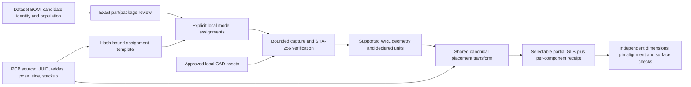

# Offline component model assignments

This original pure-Rust boundary supplements existing PCB data without rewriting
the dataset or claiming that a BOM contains a physical layout. A footprint is the
pad/land pattern and its graphics; a component body is a separate 3D asset. Existing
PCB footprint coordinates remain authoritative. Generating new manufacturing
footprints requires package dimensions, pad/pin numbering and a reviewed land
pattern; a part value or BOM label is insufficient.



## Commands

```text
tokito-cli model assignments template board.kicad_pcb --output assignments.json
tokito-cli model assignments verify board.kicad_pcb --manifest assignments.json --project-root C:\approved-models --json
tokito-cli export glb board.kicad_pcb --model-assignments assignments.json --project-root C:\approved-models --output assigned.glb --allow-partial --json-report
```

Board arguments also accept supported Tokito packages. Templates retain every
source component with `model: null`, exact UUID/refdes/ordinal, identity issues,
unknown population and no invented transforms. The manifest is pinned to the
original board SHA-256. Explicit models require path, original-byte SHA-256,
`millimetres` or `kicad-wrl` units, scale, rotationDeg and offsetMm. No implicit
unit conversion or guessed offsets are supplied. Paths resolve only within
approved roots, with no recursive filename matching or network downloads.

Parsing is capped at 4 MiB, 10,000 assignments and 4096 bytes per field. Duplicate
keys, conflicting identities, wrong board hashes, changed model bytes, nonfinite
transforms and zero scales are refused. Assets are bounded individually and in
aggregate. Missing assets and unsupported geometry remain explicit unresolved
states. STEP, glTF and GLB component parsing are not admitted by this feature.

## Rendering and qualification

This is an assignment-only export mode; it cannot be combined with
`--assemble-wrl`. Authored PCB model references remain unchanged and unattempted,
and assigned bodies never inflate authored-reference emission counts. Primitive
provenance records manifest SHA-256, entry index and captured asset SHA-256;
canonical component provenance retains its real saved source node. Each rendered
component has a mesh-bearing UUID-backed `ref:<refdes>` node.

Explicit `not-fitted` and `no-part-to-order` claims exclude bodies but remain in
the per-component report. Claims are not verified population evidence. Unassigned,
anonymous, placeholder and unresolved records remain visible. Reports are bounded
with correct totals and truncation flags. A body requires unique source identity,
supported geometry, finite canonical pose and consistent supported stackup.

Every assigned export requires `--allow-partial`, even if every identifiable
component has a body. Rendered coverage is distinct from engineering acceptance:
exact manufacturer part, package/pin-one alignment, mounting height, physical
revision, body dimensions and independent reference surfaces remain unverified.
No board shell, generic box or guessed body counts as a resolved component.

## Evidence and remaining work

The subprocess test independently decodes GLB positions, checks hand-calculated
front/back poses and manifest provenance, exercises a real pinned KiCad resistor
body, and verifies population exclusions and hash/board refusal paths. The test
fixture is not evidence that any dataset component matches that resistor model.
Existing component-pose tests cover nonzero local transforms and signed-scale
winding. Actual dataset templates are inventory evidence only until real model
assignments and independent engineering comparisons are provided.

DigiKey enrichment is optional future desktop preparation. Its official
[ProductDetails interface](https://developer.digikey.com/products/product-information-v4/productsearch?page=0)
supports exact part lookup and its [Media interface](https://developer.digikey.com/products/product-information-v4/productsearch/media)
provides available media; this is not a universal footprint/model generation
service. Local generation must remain independent of network availability.
KiCad documents [footprint geometry](https://dev-docs.kicad.org/en/file-formats/sexpr-footprint/)
and [separate footprint-model transforms](https://dev-docs.kicad.org/en/file-formats/sexpr-intro/).

Next gates: exact dataset part/model associations, supported STEP surface/trim
implementation, pin/pad correspondence, independent pose and body-dimension
comparisons, and whole-populated-board acceptance. See
[BOM qualification](BOM_COMPONENT_QUALIFICATION.md) and
[STEP qualification](DATASET_STEP_QUALIFICATION.md).
