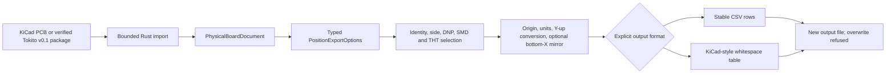

# PCB manufacturing-position export

`pcb export pos` is a pure-Rust manufacturing-position projection, separate
from `export placements`. The latter remains the raw identity inventory in the
saved KiCad board frame; POS transforms coordinates and applies placement
selection rules for a downstream manufacturing workflow.

Tokito currently supports bounded CSV and KiCad-style ASCII subsets. They share
one canonical projection for UUID-bound footprint identity, side/DNP/SMD/THT
selection, origin translation, unit conversion, bottom-side X mirroring and
sorting. The CLI does not start KiCad and requires an explicit format and a new
output path.

## Data path



The public `PhysicalBoardDocument::export_pos_csv` and
`PhysicalBoardDocument::export_pos_ascii` APIs share the same projection. The
CLI only parses arguments, loads a supported PCB or Tokito package, calls the
appropriate serializer and writes the result.

## Usage

```powershell
tokito-cli pcb export pos board.kicad_pcb `
  --format csv --output placements.csv --side both --units mm `
  --bottom-negate-x --exclude-fp-th --exclude-dnp

tokito-cli pcb export pos board.kicad_pcb `
  --format ascii --output placements.pos --side both --units mm `
  --use-drill-file-origin
```

`--format csv|ascii` and `--output <FILE.csv|FILE.pos>` are required.
Defaults for the shared projection are both sides, inches, absolute board
origin, no bottom-X negation and no additional SMD/THT/DNP filters. Footprints
marked `exclude_from_pos_files` are omitted by default. Existing destination
files are never replaced.

| Option | Tokito behavior | Current reference evidence |
|---|---|---|
| `--side front|back|both` | Select F.Cu, B.Cu, or both | Uno, NXP; ASCII front/back captures |
| `--units in|mm` | Converts source millimetres; default is inches | Uno, NXP, SparkFun, Pico |
| `--bottom-negate-x` | Negates X only for B.Cu rows, after origin translation | NXP and Pico |
| `--smd-only` | Keeps footprints carrying the `smd` attribute | Uno CSV capture |
| `--exclude-fp-th` | Omits any footprint with a `thru_hole` or `np_thru_hole` pad; refuses unclassified pads rather than guessing | Uno and SparkFun |
| `--exclude-dnp` | Omits footprints marked DNP | Uno and NXP |
| `--use-drill-file-origin` | Uses finite `setup/aux_axis_origin`: X = sourceX − originX, Y = originY − sourceY; absent origin falls back to (0,0); malformed/ambiguous origins are refused | SparkFun and Pico; Uno verifies fallback |

Rows are ordered bottom side first, then top side, with natural reference order
within each side. KiCad and Tokito may order footprints with empty references
differently; comparison preserves the order of named references and checks
empty-reference rows as an unordered value set.

### CSV

CSV begins with `Ref,Val,Package,PosX,PosY,Rot,Side`. Fields are quoted and
embedded quotes doubled; numeric fields use six fractional digits. The current
CSV reference corpus covers 14 option/board cases in KiCad 10.0.5 and 10.0.7.
Twelve 10.0.7 outputs match after line-ending normalization; two Pico outputs
match in named-row order and empty-reference row values.

### ASCII

ASCII uses a whitespace-aligned table, minimum reference/value/package column
widths, spaces changed to underscores in text fields, four decimal places,
front/back side labels and a terminating `## End`. It allows bounded printable
Unicode text, but rejects control characters, line separators and bidi-format
characters. Each identity field is capped at 1,024 UTF-8 bytes and the complete
serialized file at 32 MiB; the exporter checks the output size before reserving
or writing the buffer. Column width follows Unicode scalar count, so terminal
cell alignment for wide or combining characters is not qualified; use CSV when
that presentation matters. Tokito identifies its own tool/version and writes a
UTC timestamp in the header; native KiCad uses its own build version and
host-local timestamp. Comparisons validate both exact tool/version headers,
then normalize only those two lines and CRLF-to-LF line endings.

Nine captured KiCad 10.0.5 cases cover Uno units, NXP front/back, bottom-X,
DNP filtering, SparkFun auxiliary origin/THT filtering, and Pico auxiliary
origin with bottom-X. Eight match exactly after header and line-ending
normalization. The Pico case compares every named-reference row in order and
every empty-reference row as an unordered value set. Tokito
does not claim KiCad 10.0.7 ASCII runtime parity.

The ASCII serializer refuses control characters in reference/value/package
fields so source text cannot inject extra output lines. CSV remains the
recommended option when text fields contain delimiters or characters that do
not fit the ASCII table representation.

## Reference evidence and scope

The official [KiCad 10.0 CLI manual](https://docs.kicad.org/10.0/en/cli/cli.html#pcb-export-pos)
documents the POS command and its format options; that manual is based on KiCad
10.0.7. The pinned [KiCad 10.0.7 placement exporter source](https://gitlab.com/kicad/code/kicad/-/raw/10.0.7/pcbnew/exporters/place_file_exporter.cpp)
was used to verify table fields, sorting, formatting and transforms. Source is a
behavior reference only; Tokito's Rust implementation is original.

The [10.0.5 CSV manifest](../tests/reference/kicad-cli-10.0.5/pos/manifest.json),
[10.0.7 CSV manifest](../tests/reference/kicad-cli-10.0.7/pos/manifest.json)
and [10.0.5 ASCII manifest](../tests/reference/kicad-cli-10.0.5/pos-ascii/manifest.json)
record source/output hashes, options, tool versions and case counts. The E2E
test runs Tokito against those checked-in outputs; it does not invoke KiCad.
The 10.0.5 ASCII captures were generated locally from the listed fixtures using
the installed reference executable and are not evidence of 10.0.7 runtime
behavior.

KiCad POS options not implemented include variants, BOM exclusion and Gerber
format/output, along with full default/error and edge-case parity. This is not
complete POS parity or complete KiCad CLI parity. SVG/GLB/STEP exports, DRC,
schematic, symbol and broad footprint-library workflows remain separate open
work.
