# PCB manufacturing-position CSV

`pcb export pos` is a narrow, pure-Rust manufacturing-position exporter. It is
separate from `export placements`: the older operation remains a byte-stable
inventory in the saved KiCad board frame, while POS converts that inventory to
the CSV conventions verified against a KiCad reference executable.

## Data path

```mermaid
flowchart LR
    PCB[KiCad PCB or verified Tokito v0.1 package] --> Import[Bounded Rust import]
    Import --> Canonical[PhysicalBoardDocument]
    Canonical --> Request[Typed PositionExportOptions]
    Request --> Project[Side / DNP / SMD / through-hole selection]
    Project --> Transform[Units, board Y to POS Y, optional bottom X mirror]
    Transform --> CSV[Stable CSV rows]
    CSV --> Writer[Explicit new output path; overwrite refused]
```



The public `PhysicalBoardDocument::export_pos_csv` method and the CLI share the
same projection. The CLI only parses arguments, loads a PCB or supported Tokito
package, calls that method, and writes the result. It never starts KiCad.

## Usage

```powershell
tokito-cli pcb export pos board.kicad_pcb `
  --format csv --output placements.csv --side both --units mm `
  --bottom-negate-x --exclude-fp-th --exclude-dnp
```

`--format csv` and `--output <FILE.csv>` are required. Defaults match the tested
KiCad CSV slice where applicable: both sides, inches, no bottom-X negation, and
no extra SMD/THT/DNP filters. Footprints marked `exclude_from_pos_files` are
omitted by default. CSV strings are quoted and embedded quotes are doubled;
numeric fields use six fractional digits. Rows are grouped bottom side first,
then top side, with natural reference-designator ordering within each side.

| Option | Tokito behavior | Current evidence |
|---|---|---|
| `--side front|back|both` | Selects F.Cu, B.Cu, or both | Uno and NXP reference CSVs |
| `--units in|mm` | Converts source millimetres; default is inches | Uno in/mm reference CSVs |
| `--bottom-negate-x` | Negates X only for B.Cu rows | NXP back-side reference CSV |
| `--smd-only` | Keeps footprints carrying the `smd` attribute | Uno reference CSV |
| `--exclude-fp-th` | Omits a footprint with any `thru_hole` or `np_thru_hole` pad; refuses an unclassified pad rather than guessing | Uno plated-pad and SparkFun NPTH reference CSVs |
| `--exclude-dnp` | Omits footprints marked DNP | Uno reference CSV |

The board absolute origin is used. `--use-drill-file-origin`, variants, ASCII,
Gerber, and `--gerber-board-edge` are explicitly unsupported. The importer does
not retain a verified auxiliary origin, and there is no Gerber-position writer.
Unsupported options fail before writing output. Existing destination files are
never replaced. The implementation does not claim KiCad's full command syntax:
KiCad defaults to ASCII, while Tokito requires explicit `--format csv` because
only the CSV subset has been independently captured.

## Reference evidence

The reviewed primary-source manual documents the KiCad 10.0 option surface and
defaults: [KiCad 10.0 CLI manual, PCB position export](https://docs.kicad.org/10.0/en/cli/cli.html#pcb-export-pos).
On 2026-10-11, the installed reference executable reported KiCad CLI 10.0.5.
Its outputs were captured from the pinned Uno, NXP MCXA ESC, and SparkFun PCB
fixtures. [The manifest](../tests/reference/kicad-cli-10.0.5/pos/manifest.json)
records each source and reference-output SHA-256. Rust unit tests compare whole
CSV content after normalizing only platform line endings; subprocess E2E tests
also exercise command parsing, package input, unsupported-option refusal, and
no-overwrite behavior. Tokito's product path has no KiCad runtime dependency.

These comparisons establish only the listed CSV behavior against KiCad 10.0.5.
The repository's proposed parity target remains KiCad 10.0.7, so this work does
not establish 10.0.7 parity or complete KiCad CLI parity. Auxiliary origin,
variants, other POS formats, SVG/GLB/STEP export semantics, DRC, schematic and
footprint-library workflows remain separate open work.
