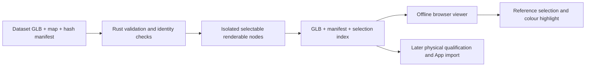

# Offline selectable board prototype

The Rust CLI prepares the dataset's existing component geometry and generates a standalone browser viewer. It does not claim to have generated or independently qualified the source CAD bodies. The viewer is unregistered inspection: it cannot authorize physical AR guidance.

## Generate and open

```text
tokito-cli twin prototype board.glb --component-map component-map.json --manifest digital-twin.json --output new-prototype-folder
```

Open `new-prototype-folder/index.html` in a WebGL-capable desktop browser. No server, CDN, login or internet connection is needed. Select a reference in the list, filter by authored class or reference, rotate and zoom. A selected component receives a distinct colour; clearing selection restores its original colour. Missing models stay visible in the inventory and cannot be mistaken for selectable geometry.

The command shares `twin prepare` validation and refusal behavior. Missing required models require explicit `--allow-partial`. Existing output directories are refused. The GLB binary geometry payload and node transforms remain unchanged. Generated JSON, map and GLB files accompany the viewer so provenance and limitations remain inspectable.



## First real candidate

The pinned NXP dataset asset contains 391 reference entries, 354 mapped renderable component meshes and one unmapped renderable mesh. The other 37 entries have no selectable body. The source declares Rev C; equivalence to the photographed B-marked board remains unverified. Model-quality labels are dataset claims, not CLI certifications. The prototype preserves actual source surfaces and transforms rather than replacing missing components with invented boxes.

The pinned dataset PR #13 Ultimainboard 2.1.4 assembly is now supported through `twin adapt-source`: 310 selectable body groups, including 94 multi-mesh components. Four package bodies are missing and four spacer bodies/populations remain unresolved. The adapter and source E2E preserve exact geometry, materials, identities and transforms. See [Ultimaker prototype](ULTIMAKER_SELECTABLE_PROTOTYPE.md). ESP12E PR #12 supplies reviewed bodies/contacts in photos, not an assembled selectable GLB.

## Acceptance and limits

Local Rust checks and actual browser journeys must verify loading, visible geometry, distinct reference selection, missing-model reporting, restoration, rotation/zoom and offline execution. Browser screenshots inspect appearance; they do not establish dimensional accuracy or physical fit. Rendering at 3840 x 2160 is a visualization check separate from CAD accuracy.

Physical measurements, component-to-PCB UUID crosswalks, complete fitted-part coverage, source-to-specimen identity, photographic registration and Android acceptance remain open. The pure-Rust shipping engine never invokes KiCad or FreeCAD. Browser presentation code uses built-in WebGL and does not add a native CAD dependency.
