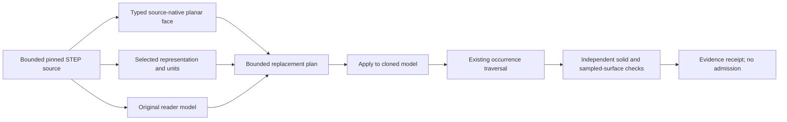

# Experimental original Rust STEP planar-face repair

This is a development evaluator path, not production STEP support. It keeps
exit code 2, `admitted: false` and `exportsProduced: []`. The production CLI
does not silently enable it. Source files and the original reader model remain
unchanged. AR/YOLO and sibling repositories are outside this work.

## Flow and boundaries



The original Rust source-face path preserves every boundary point, explicit
orientation and source ID. Its typed geometry is separate from JSON projection.
The repair requires one matching shape item, a bounded plain representation
link path from the reader's primary representation to the selected owner,
independently resolved selected length units and positive finite model scale.
Transformed relationships are not followed as plain local-frame links.

The target face's used mesh vertices must correspond one-to-one to the source
boundary. Nearest matching uses the caller's explicit source-unit tolerance,
converted once to model units; ambiguous, distant or duplicate matches refuse.
Existing positions and shared indices are reused. Mapped triangles must retain
finite positive normal agreement. No shape-wide weld, vertex movement,
degenerate deletion, guessed rigid alignment or new occurrence transform occurs.

Only the target face's triangles, aligned face IDs and uniform optional face
colours are replaced on a clone. Conflicting colours and malformed metadata
refuse. All other triangles, shape metadata and occurrence transforms remain.
This establishes a bounded candidate operation, not proof of every possible
source owner or arbitrary transformed representation behavior.

## Explicit invocation

```powershell
tokito-step-evaluation --repair-planar-face 51071 --source-tolerance 0.000001 --source-representation 58073 C:\path\to\14.step
```

This emits an experimental JSON candidate and repair report to standard output.
It does not write a production GLB or STEP file. The supported profile is one
explicit planar outer LINE loop; inner loops, curves and spline surfaces remain
unsupported by this repair path.

The pinned model-14 first candidate reused all 148 boundary vertices with zero
match distance, replaced 146 target-face triangles with 146 source-derived
triangles and emitted no degenerate triangles. All 41 emitted shape occurrences
passed index-based closure, winding and positive-volume checks. Independent
surface/volume comparison remains a separate recorded gate; these observations
alone do not establish model qualification.

The corrected independent comparison subsequently passed for this pinned
fixture: 41 shape occurrences across 36 occurrences, zero degenerate triangles,
closed/consistent/outward meshes and unchanged unrelated data. It sampled
300,000 points in each direction against the digest-pinned FreeCAD v2 reference;
maximum sampled distance is 0.0014101133940020597 mm against the unchanged
0.02 mm threshold. Candidate signed volume is 640.7857035362048 mm3 versus
640.8057861573081 mm3, within the existing 0.06408057861573081 mm3 tolerance.
The independent distance stage used 17,393,370 triangle evaluations, below
the unchanged 50,000,000 cap. This is sampled agreement, not a continuous
surface-error guarantee, material qualification or physical-board equivalence.

## Emitted-shape source-face provenance gate (2026-10-20)

The evaluator now reports a separate `emittedShapeFaceProvenanceAudit` instead
of leaving the per-shape results buried in diagnostic details. On the pinned
model-14 input, the reference E2E audited all 14 emitted reader shape
definitions, covering 1,223 distinct source-face memberships. Each source
topology traversal completed; emitted and expected face-ID inventories matched;
triangle/provenance lengths matched; and no face ID was omitted, unexpected,
or unassigned. The repair kept the same inventory and replaced the 146 triangles
at item `46427`, face `51071`, while reusing all 148 source-boundary vertices.

The independent FreeCAD reference comparison still passes at a maximum sampled
bidirectional distance of `0.0014101133940020597 mm` against the pinned
`0.02 mm` threshold. The receipt records the exact source, reference, evaluator
and harness digests in
`F:\kannan\projects\tokito-cli-verification\step14-source-face-provenance-20261020b\receipt.json`;
its SHA-256 is
`e59421f3ceb48e0da76820d7b112d11b59e4ecaee600925800f722a4010b03aa`.
The compact checked-in summary is
[`model14-source-face-provenance-20261020.json`](evidence/model14-source-face-provenance-20261020.json).

This gate is deliberately narrow: it checks source-face provenance for every
shape definition emitted by this reader run. It does **not** enumerate every
source representation item, prove that the reader emitted every source shape,
verify per-face tessellation fidelity, certify continuous surface error, or
prove component/PCB identity and placement. The report therefore keeps
`allSourceRepresentationItemsEnumerated`, `allSourceShapesCovered`,
`geometryQualified`, and `admitted` false. Production STEP support remains
disabled.

Run e evidence is
`F:\kannan\projects\tokito-cli-verification\step14-repair-reference-20261016e/receipt.json`.
The final checker adds explicit independently audited unit-conversion assertions;
run f passed and records that final-code comparison at
`F:\kannan\projects\tokito-cli-verification\step14-repair-reference-20261016f/receipt.json`.
Runs a/b were interrupted/non-passing;
c/d failed the distance-work budget. None is counted as successful evidence.
Performance corrections preserved samples, thresholds and the evaluation cap.

## Verification and remaining gates

The Rust tests cover input immutability, preserved positions/occurrences,
unrelated triangles, optional colour alignment, ambiguous identities, malformed
metadata, boundary mismatch, unit conversion once and nonfinite numerical
refusal. Subprocess tests enforce explicit owner selection and non-admission.

`experiments/step-evaluation/tests/planar_repair_reference_e2e.py` compares fresh
baseline/repaired evaluator output to a digest-pinned independent FreeCAD v2
reference. It retains failure receipts and checks source hashes, unchanged
unrelated data, nondegeneracy, per-shape closure/winding, aggregate volume and
bounded bidirectional sampled surface distance. Sampling is not a continuous
Hausdorff bound or per-component engineering certification. FreeCAD reference
solid ordinals are not STEP entity identities.

An independent original Rust `surface_distance` example performs that bounded
distance stage. It is development tooling with no CAD bindings or admission
path. Analytic triangle/segment tests, nonzero Python cross-checks and a
64-triangle BVH-versus-full-scan regression cover its geometry/pruning paths.
It caches exact repeated queries, prunes individual triangle bounding boxes
and stops only when the exact global lower bound zero is found. Streaming
fingerprints cap inputs and retain failed receipts. The local verifier adds
its test and optimized build gates, bringing the base profile to 45 gates.

Next gates are stricter global source/frame ownership, generalized supported
profiles, rational-spline repair for model 16,
per-component dimensions/identity/placement qualification and explicit product
adapter acceptance. General STEP support and full KiCad parity remain open.

## Primary-source research

### Next non-planar failure: bounded emitted-triangle diagnostic

Model `16.step` SHA-256
`7234dff19581f670dd0f65f1b3c5d76abb6054004ffea8627bf0ef505f66138f`
has face #2875 on rational surface #10410, with U degree 2, V degree 9,
3x18 controls and positive weights. Its declared closed V seam is supported
by equal first/last control points in each U row. Its four-edge trim loop
closes by source vertex IDs; trim curves are direct 3D splines, not supplied
UV pcurves. Curve knot intervals cannot be treated as surface UV coordinates.

The experimental evaluator now accepts `--diagnose-face 2875 PATH_TO_16.step`.
It reports observations without changing geometry, producing an export or
admitting the model. This is development tooling, not a product CLI command.
The 2,506 triangles on this face include 520 coincident-position triangles
with distinct vertex indices and 582 relatively near-zero triangles that are
exactly noncollinear in binary64. There are no repeated-index or exactly
collinear distinct-position triangles in that rejected group. These counts
refer only to the part-local mesh coordinates examined by the Rust diagnostic;
they do not assert equal results after occurrence transforms.

Inspection budgets cover the whole reader mesh (two million triangles and one
million vertices), while detailed records are capped at 128. Relative-area
classification normalizes edge vectors before multiplication to avoid small
scale underflow. An independent review found that issue; scale-invariance
regressions now cover it. Exact collinearity uses original coordinates.
Tests also cover input immutability, malformed metadata/indices, excessive
resources and real subprocess non-admission. The pinned-asset negative E2E at
`experiments/step-evaluation/tests/model16_face_diagnostic_e2e.py` verifies
model-16 face #2875 counts, source/evaluator digests and refusal status while
retaining its output receipt outside the repository. No UV coordinates are exposed by
the reader mesh. Source-surface evaluation, seam/trim branch mapping and an
independent per-face comparison remain required to establish the cause and
justify a repair. A closed seam alone is not proof of a singular surface.
Do not apply the planar repair to this non-planar face or delete triangles to
conceal the defect.

The dataset's rational B-spline declaration carries degrees, control points,
closed flags, weights and knot data; those are distinct inputs to surface
evaluation and trim mapping. The STEP Tools schema documents those fields.
The Open CASCADE meshing guide describes discretizing 3D curves and associated
2D face curves into an edge skeleton, then checking the discrete model before
face meshing. This is useful behavior to compare during a future original
Rust implementation; it does not establish that the source curves are valid
or that this reader used the same process.

### Reference documentation

Consulted 2026-10-16:

- [STEP Tools face_bound schema](https://www.steptools.com/stds/stp_aim/html/t_face_bound.html): bound topology and its orientation are explicit fields.
- [STEP Tools face_surface schema](https://www.steptools.com/docs/stp_aim/html/t_face_surface.html): surface geometry and `same_sense` are separate from the bound.
- [STEP Tools B-spline surface schema](https://downloads.steptools.com/docs/cislib/html/t_b_spline_surface.html): declares degree, control-point grid, closed flags and related surface fields.
- [Open CASCADE meshing guide](https://github.com/Open-Cascade-SAS/OCCT/blob/master/dox/user_guides/mesh/mesh.md): describes linear/angular deflection, 2D and 3D curve discretization, face meshing and discrete-model checks. This is research guidance, not a copied algorithm or runtime dependency.
- [KiCad footprint format](https://dev-docs.kicad.org/en/file-formats/sexpr-footprint/index.html) and [courtyard conventions](https://klc.kicad.org/footprint/f5/f5.3/): references for the separately tracked library-generation work; current structural audit is not land-pattern or standards qualification.

See [reference evidence](STEP_SOLID_REFERENCE.md), [v1 requirements](CLI_V1_PLAN.md)
and [goal tracker](GOAL_TRACKER.md).
