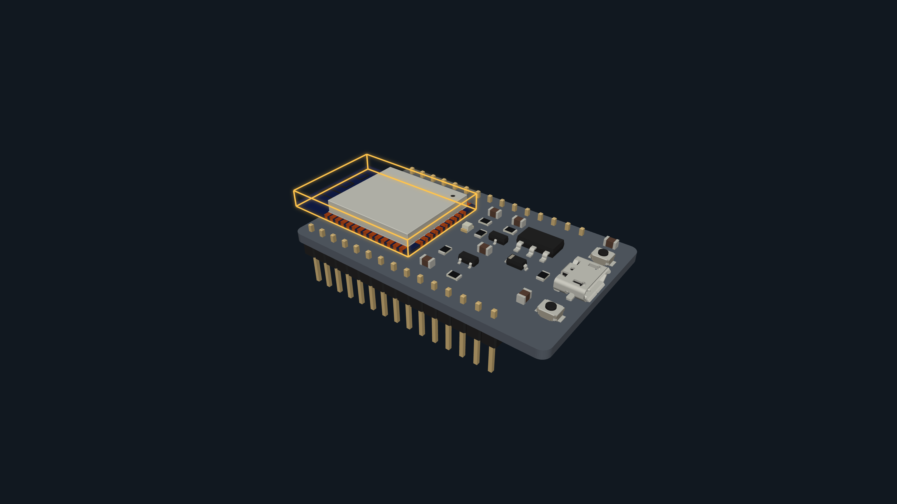

# Windows browser end-to-end evidence — 2026-10-17

## Scope and result

This report records local rendering and browser behavior for the six checked-in
board prototypes. It tests component-list selection, visible selection outline,
stable source appearance, 3840 × 2160 PNG export, lighting mode changes, missing
model disclosure where present, offline selection, and the declared GPU-limit
refusal. It does **not** qualify physical geometry, material accuracy, AR
registration, electrical behavior, production release readiness, or complete
component coverage.

The final headless and visible Windows Edge runs passed on all six boards. An
earlier visible six-board attempt passed ESP32 and then failed while reloading
ESP32-natural because the page/context/browser closed. That failure remains in
the evidence. The GPU-limit test now starts in a fresh browser context instead
of reloading a live WebGL page; a later full headed run passed. This avoids the
observed reload path but does not establish the original root cause.

## Environment and inputs

- Checkout: `F:\kannan\projects\tokito-cli-verification\pr45-working-copy-20261017`
- Release CLI source revision: `8fb002d5b613b6f5c726100050d4359e84b33c3c`; the browser test and runner were the working-tree versions identified by their SHA-256 values below.
- Branch: `feat/footprint-spec-generator`
- Release CLI: `F:\kannan\projects\tokito-cli-verification\builds\pr45-local-verify-20261017\20261017T155149Z-36d91b4b93bc46c88265e366541776e9\release\tokito-cli.exe`
- CLI SHA-256: `fe497d72e10ab417011119a7d8b7681cbcd440f8b6b40c0801e184afbdf02cd`
- CLI version: `tokito-cli 0.1.0`
- Browser: Microsoft Edge `155.0.4283.45`
- Playwright: installed module at `C:\Users\PC\.cache\codex-runtimes\codex-primary-runtime\dependencies\node\node_modules\playwright`; version `1.62.1`
- Browser test source SHA-256: `6cd371a577a519e46eb46ae0e44ae392e6e48c33b455fac89ee4f7fddf4c2acc`
- Browser runner SHA-256: `40eb67a74583dd33587349454438e574e4d996a336659ace459e9d87587b9970`

The CLI produced local `twin prototype` assets from the six checked-in fixture
boards under `output/playwright/pr45-gui-20261017/viewers/`. The exact binary,
GLB, viewer, component map, index, and manifest hashes are recorded in each
board's browser receipt and generated project manifest. Partial export was
explicitly accepted where the fixture reports missing models.

## Passing results

Headless six-board receipt:
`output/playwright/pr45-gui-20261017/headless-fresh-context/receipt.json`

Receipt SHA-256: `023d24914a325707e3a9a14299a6945c63ed3775e33cab2a3bf61ac6ce3b8106`.

| Board fixture | Components | Rendered triangles | Missing model exercised | 4K image SHA-256 |
| --- | ---: | ---: | --- | --- |
| ESP32 | 26 | 30,754 | U3 | `505e13d01d0f24da5ea78d099bc68c7fc681ef94aa8266d13a1e496d4621239e` |
| ESP32-natural | 26 | 30,754 | U3 | `9710625a6e676aee13779926193295409d8b605d95489cc27e4404a1c2966a59` |
| ESP8266 | 34 | 405,594 | No missing-model entry | `788f7107bd6a3d14efe0f235719fc3f8f6f076ea8f87f3b5b04e25ad21fa6edf` |
| NXP reference | 391 | 108,920 | BH1 | `73fdcf9688f2e146392dad70c181248caad9a28aa4afc0f94a82f6f8aa0a2a04` |
| NXP refined | 391 | 274,908 | BH1 | `af5832fd443b6d63997a414a510eae9f16912eb40668a1401aa4040f85d1f555` |
| Ultimaker | 574 | 712,527 | TP527 | `7b683195ffd2571f1fc9a1af950d40acf0df8d8f829e74dec96a2cdd96a15580` |

Each run verified an actual 3840 × 2160 export and the UI reports the selected
reference exactly. ESP8266 has no missing model in its fixture, so the UI
missing-model disclosure path was covered by the other five boards.

Visible Edge receipt:
`output/playwright/pr45-gui-20261017/headed-esp32-final/receipt.json`

The visible run passed the same checks for ESP32. Receipt SHA-256:
`b648e47889a1ad1e7629caaadf4a5fbb3f0746a7baaff2158fe4c2074860e826`. Its 4K PNG SHA-256 is
`505e13d01d0f24da5ea78d099bc68c7fc681ef94aa8266d13a1e496d4621239e` and is
included as a review image:



Reproduce the browser runs from the checkout root, supplying the installed
Playwright module and a new empty output directory:

```powershell
node tests/run_presentation_browser.cjs <installed-playwright-module> output/playwright/pr45-gui-20261017/viewers <new-output-directory>
node tests/run_presentation_browser.cjs <installed-playwright-module> output/playwright/pr45-gui-20261017/viewers <new-headed-output-directory> --headed
```

The final all-board visible Edge receipt passed all six boards:
`output/playwright/pr45-gui-20261017/headed-fresh-context/receipt.json`

Receipt SHA-256: `d5ef1ffc5838ac3df75cef3d80e1142c620e7e1f8ffdc87629b39aadc18317c6`.

## Failed attempt retained

Receipt:
`output/playwright/pr45-gui-20261017/headed-retry/receipt.json`

Receipt SHA-256: `1bcb383d278a043907e64410065519bbf6036b29774a1dc78a970049a30d72ab`.

The visible six-board attempt passed ESP32, then failed on ESP32-natural with
`page.reload: Target page, context or browser has been closed` while waiting for
navigation to the local `file:` viewer. No root cause was established. The
updated six-board headless and visible runs both passed after the GPU-limit
probe switched to a fresh context, avoiding that reload path.

## Local CLI verifier

The final Windows local verifier passed **48/48** gates on 2026-10-17 using
Windows 10.0.26200 x64, Cargo/Rust 1.94.1 and Python 3.11.5. It ran unit tests,
Clippy, release build, CLI and board E2E, KiCad 10.0.7 reference checks, STEP
and Altium experiment suites, and output-path safety checks. It reused the
existing Cargo target on F:; this is not a clean-cache, fresh-machine, or
installer/upgrade result.

The exact current-source verification receipt path and SHA-256 are recorded
in the PR update. Reports are retained outside the checkout under
`F:\kannan\projects\tokito-cli-verification\deliveries\pr45-local-20261017\`.

The receipt reports the tested CLI SHA-256 as
`fe497d72e10ab417011119a7d8b7681cbcd440f8b6b40c0801e184afbdf02cd` and retains
the explicit limitations that STEP/glTF/GLB equivalence, physical fit, App,
phone/AR and Desktop acceptance are unverified.

## Geometry and release boundary

The browser receipts keep `geometryQualified: false`. Rendering an image at 4K
proves output resolution, not CAD accuracy. Current fixture manifests continue
to report physical fit, board registration, complete model coverage, and AR
positional guidance as unverified/false where applicable. These browser passes
do not make V1 production-ready and do not close the outstanding independent
STEP solid qualification or KiCad/library parity work.
